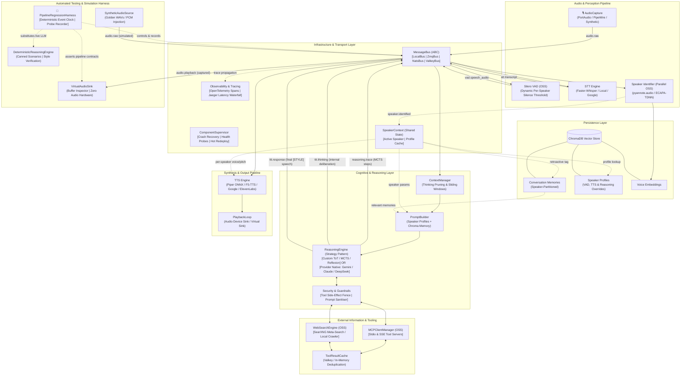

# MindMirror: Distributed Real-Time AI Voice Assistant Pipeline

MindMirror is an end-to-end, fault-tolerant, and modular conversational AI voice assistant pipeline. It unifies Speech-to-Text (STT), Text-to-Thought (TTT / Large Language Models with Pluggable Reasoning), and Text-to-Speech (TTS) into a seamless, low-latency, real-time voice streaming loop.

Engineered with an Erlang-style supervisory architecture, pluggable distributed message transports (Local, ZeroMQ, NATS, Valkey), parallel background speaker identification, partitioned ChromaDB vector memory, Model Context Protocol (MCP) tool-use, strict security guardrails, and OpenTelemetry observability, MindMirror is built for both local, air-gapped open-source deployment and hybrid cloud setups.

---

## Origin

MindMirror originated as a personal research experiment exploring the concept of *self-directed conversational AI* — specifically, whether a system could facilitate a real-time dialogue in which a user interacts with a language model that responds in their own synthesised voice. The hypothesis was that such a setup could serve as an audible externalisation of inner monologue, prompting deeper reflection through the medium of conversation. As the architecture evolved and additional components were integrated, the project naturally matured into an enterprise-ready, general-purpose local voice assistant pipeline.

---

## Key Architectural Highlights

- **Pluggable Message Transport Layer (`MessageBus`):** Fully decoupled publish/subscribe and request/reply messaging backing all inter-component communications:
  - **`LocalBus`**: Ultra-low latency, in-memory `asyncio.Queue` transport for single-process operation.
  - **`ZmqBus`**: High-throughput ZeroMQ IPC/TCP transport for distributed processes with zero external broker daemon.
  - **`NatsBus`**: Cloud-native pub-sub and JetStream streaming queues for distributed cluster deployments.
  - **`ValkeyBus`**: Open-source, high-performance Redis-compatible distributed pub-sub bus.
- **Erlang-Style Supervisor & Self-Healing:** The `ComponentSupervisor` actively monitors child pipeline processes (`ComponentHealth`), automatically recovers failing components with exponential backoff, and supports **live zero-downtime blue-green hot swapping** ([scripts/deploy_component.py](scripts/deploy_component.py)) without dropping in-flight transcripts or audio frames.
- **Parallel Background Speaker Identification:** Processes voice embeddings (PyAnnote / ECAPA-TDNN) concurrently alongside STT audio transcription. Automatically attributes transcripts to enrolled speakers, applies **retroactive memory tagging** to ChromaDB session facts, and dynamically adapts runtime behavior (custom VAD silence thresholds, individual voice cloning profiles, and personalised system prompts).
- **Pluggable Reasoning Engine & Stream Phase Demuxing:** Strategy pattern supporting both native cloud reasoning (Gemini, Claude, DeepSeek) and custom algorithmic reasoning (Tree-of-Thoughts, MCTS, Reflexion). Enforces strict envelope phase separation (`StreamPhase.THINKING` vs `StreamPhase.RESPONDING`), guaranteeing internal deliberation traces never leak into audible speech synthesis.
- **Emotional Style Tag Protocol:** Strict contract where all agent responses begin with an emotional style tag (`[NEUTRAL]`, `[EXCITED]`, `[SERIOUS]`, `[LAZY]`). The TTS engine dynamically parses these tags to adjust pitch, speaking rate, and reference audio clips to match emotional delivery.
- **Persistent Partitioned Vector Memory:** Built on ChromaDB, partitioned per speaker. Enables semantic context retrieval (`recall_memories`), persistent fact storage (`remember_fact`), and dynamic memory enrichment via background message bus events.
- **External Tools & Security Guardrails:** Decoupled Model Context Protocol (`MCPClientManager` supporting stdio and SSE servers), privacy-first local web search (`WebSearchEngine` via self-hosted SearXNG), tool execution caching (`ToolResultCache`), two-tier side-effect fencing (read-only execution vs mutation barriers), and strict prompt injection sanitisation.
- **Glass-to-Glass Distributed Observability:** Complete OpenTelemetry (OTel) instrumentation tracking end-to-end latency waterfall spans (Audio Capture ➔ VAD ➔ STT ➔ Speaker ID ➔ Context & Reasoning ➔ TTS ➔ Playback Sink) with native Jaeger visualization.
- **Hermetic Zero-Hardware Regression Suite:** Complete test harness using `SyntheticAudioSource` and `VirtualAudioSink` to validate 7 Golden Regression Scenarios with strict SLA latency budgets without requiring physical sound cards or live API keys.
- **Swappable Multi-Model Implementations:**
  - **STT:** `FasterWhisperSTT` (local open-source, CPU/CUDA), `LocalWhisperSTT` (on-device CUDA), `SageMakerWhisperSTT` (AWS-offloaded), or `GoogleCloudSTT` (Google Cloud Speech-to-Text V2 streaming).
  - **LLM / Reasoning:** `GeminiLLMClient` (Google Gemini via Vertex AI / AI Studio), LangChain/DeepAgents with MCP, or local Ollama LLMs.
  - **TTS:** `PiperTTS` (lightweight, fast ONNX CPU-friendly), `F5TTS` (diffusion-based voice cloning, GPU recommended), `GoogleCloudTTS` (Chirp 3 Instant Custom Voice cloning), or `ElevenLabsTTS` (ultra-low latency streaming and instant voice cloning).

---

## High-Level System Architecture



---

## Project Structure

```text
mindmirror/
├── docker-compose.yml             # Self-hosted OSS stack: NATS, Valkey, ChromaDB, SearXNG, Jaeger, Ollama
├── Dockerfile                     # Container definition for containerised pipeline deployment
├── pytest.ini                     # Pytest suite configuration & execution rules
├── master_implementation_plan.md  # Comprehensive architectural synthesis and blueprints
├── data/
│   ├── AGENTS.md                  # Runtime agent memory guidelines and tool documentation
│   ├── chroma_db/                 # Persistent speaker-partitioned ChromaDB vector database
│   ├── f5-tts/                    # Scripts and voice datasets for F5-TTS diffusion voice cloning
│   └── GoogleCloudTTS/            # Scripts and voice cloning reference audio for GCP TTS
├── scripts/
│   ├── run_regression_suite.py    # Turnkey regression test runner with Rich executive summary
│   ├── deploy_component.py        # Blue-green zero-downtime hot swapping component runner
│   ├── test_message_buses.py      # Cross-bus verification (Local, ZeroMQ, NATS, Valkey)
│   ├── test_reasoning_pipeline.py # Custom algorithmic vs native reasoning verification
│   ├── test_speaker_retroactive_tagging.py # Retroactive ChromaDB memory tagging verification
│   ├── test_supervisor_recovery.py# Supervisor crash recovery & backoff validation
│   ├── record_sample.py           # Audio sample recording for F5-TTS
│   ├── record_google_cloud_tts.py # Consent & reference audio recording for GCP TTS
│   ├── record_elevenlabs_voice_clone.py # Interactive voice cloning script for ElevenLabs
│   └── check_google_models.py     # Vertex AI model catalog validator
├── src/
│   └── mindmirror/
│       ├── config.py              # Centralised configuration source of truth
│       ├── main.py                # Primary application entry point & component composition
│       ├── audio/                 # Audio subsystem (Capture, Playback, DSP, Devices, File/Virtual Sinks)
│       │   ├── capture.py         # LiveAudioSource & supervised LiveAudioCapture component
│       │   ├── playback.py        # PlaybackState, LiveAudioSink & supervised PlaybackLoop
│       │   ├── file_io.py         # Hardware-free FileAudioSource & FileAudioSink
│       │   └── service.py         # Audio Host I/O microservice runner
│       ├── pipeline/              # Transport buses, Erlang supervisor, Component ABC, Envelope
│       │   ├── component.py       # PipelineComponent lifecycle (start, drain, stop, health)
│       │   ├── supervisor.py      # ComponentSupervisor with backoff and blue-green redeploy
│       │   ├── message.py         # PipelineMessage envelope & StreamPhase (THINKING / RESPONDING)
│       │   ├── telemetry.py       # TurnSpanTracker & glass-to-glass LatencyReport
│       │   └── transport/         # LocalBus, ZmqBus, NatsBus, ValkeyBus implementations
│       ├── speaker/               # Parallel background speaker identification & profiles
│       │   ├── context.py         # Non-blocking SpeakerContext shared state
│       │   ├── identifier.py      # AcousticVoiceEmbedder, SpeakerRegistry & SpeakerIdentifierComponent
│       │   ├── profile.py         # SpeakerProfileStore & dynamic runtime parameters
│       │   └── service.py         # Supervised speaker identification microservice runner
│       ├── llm/                   # Text-to-Thought cognitive subsystem
│       │   ├── component.py       # Supervised ReasoningComponent
│       │   ├── service.py         # Supervised autonomous reasoning microservice runner
│       │   ├── context/           # ContextManager, sliding windows & thinking pruning
│       │   ├── reasoning/         # Pluggable reasoning strategies (ToT, Symbolic PoC, Native, Local LLM)
│       │   ├── langchain/         # LangChain & DeepAgents client with MCP and ChromaDB tools
│       │   └── google/            # Direct Google GenAI SDK client
│       ├── memory/                # Persistent ChromaDB vector storage and LangChain tools
│       │   ├── chroma_client.py   # ChromaDB client factory (Remote HTTP with local PersistentClient fallback)
│       │   ├── chroma_store.py    # ChromaMemoryManager with speaker-partitioned collections & retro-tagging
│       │   └── tools.py           # remember_fact and recall_memories tools
│       ├── security/              # Tool execution side-effect fencing & prompt sanitisation
│       ├── telemetry/             # InteractionFeedbackWindow & telemetry feedback tracking
│       ├── tools/                 # SearXNG WebSearchEngine & two-tier ToolResultCache
│       ├── stt/                   # Speech-to-Text implementations (Faster-Whisper, Local, Google, AWS)
│       │   ├── component.py       # Supervised STTComponent
│       │   ├── vad.py             # Adaptive VADEngine & supervised VADComponent
│       │   └── service.py         # Supervised STT microservice runner
│       ├── tts/                   # Text-to-Speech engines (Piper, F5-TTS, Google, ElevenLabs)
│       │   ├── component.py       # Supervised TTSComponent with style tag parsing
│       │   └── service.py         # Supervised TTS microservice runner
│       └── ui/                    # Terminal audio meters and Rich visual formatting
└── tests/
    ├── conftest.py                # Common async test fixtures (LocalBus, ZmqBus, message envelopes)
    ├── unit/                      # Fast unit test suite across all decoupled components
    ├── integration/               # Bus transport, supervisor chaos, and ChromaDB integration tests
    └── regression/                # The 7 Golden Regression Scenarios (GS1-GS7)
```

---

## Turnkey Regression Suite & QA

MindMirror includes a turnkey regression test runner ([scripts/run_regression_suite.py](scripts/run_regression_suite.py)) that validates end-to-end pipeline integrity, style protocols, and SLA latency budgets without requiring physical sound hardware or live cloud APIs:

```bash
# 1. Fast Hermetic Regression (Default: 0 external APIs, 0 soundcards)
python scripts/run_regression_suite.py --mode=fast

# 2. Integration & IPC Suite (Tests ZeroMQ IPC sockets, supervisor chaos, and ChromaDB)
python scripts/run_regression_suite.py --mode=integration

# 3. Full Local OSS Suite (Full test suite across unit, integration, and regression)
python scripts/run_regression_suite.py --mode=full-oss
```

### The 7 Golden Scenarios

| Scenario ID | Name | Description | SLA Budget |
| :--- | :--- | :--- | :--- |
| **GS1** | **Full Conversational Turn** | End-to-end turn from `SyntheticAudioSource` to `VirtualAudioSink` | `< 1000ms` |
| **GS2** | **Emotion Style Contract** | Validates style tag protocol and prevents internal thinking leakage | `< 200ms` |
| **GS3** | **Barge-In Interruption Drain** | Tests instant audio ducking and synthesis queue draining on interruption | `< 50ms` |
| **GS4** | **Speculative Tool Fencing** | Validates tool result caching and side-effect safety fences | `< 150ms` |
| **GS5** | **Parallel Speaker Retro-Tag** | Background speaker ID and retroactive tagging of stored ChromaDB memories | `< 500ms` |
| **GS6** | **Prompt Injection Sanitiser** | Fences against untrusted transcript injections and system override attacks | `< 50ms` |
| **GS7** | **Supervisor Self-Healing** | Erlang-style crash recovery and zero-downtime component hot-swapping | `< 2000ms` |

You can also run standard unit and integration tests directly via `pytest`:
```bash
pytest tests/unit/
pytest tests/integration/
```

---

## How to Run

### 1. Environment Setup

MindMirror requires Python 3.12 (tested on 3.12.10 via `pyenv`):

```bash
# Create and activate virtual environment
~/.pyenv/versions/3.12.10/bin/python -m venv .venv
source .venv/bin/activate

# Install dependencies
pip install -r requirements.txt
```

### 2. Launch Open-Source Infrastructure (Optional / Recommended)

For full distributed operation (NATS, Valkey, ChromaDB, SearXNG, Jaeger), spin up the local Docker stack:

```bash
docker compose up -d
```

- **NATS Dashboard**: `http://localhost:8222`
- **Jaeger Distributed Tracing UI**: `http://localhost:16686`
- **SearXNG Meta-Search**: `http://localhost:8080`
- **ChromaDB API**: `http://localhost:8000`

### 3. Configure Credentials & Settings

Create a `.env` file in the project root:

```env
# ==============================================================================
# Google Cloud Platform (Vertex AI, Speech-to-Text & Text-to-Speech)
# ==============================================================================
GOOGLE_APPLICATION_CREDENTIALS=/path/to/your/service-account-key.json
GOOGLE_CLOUD_PROJECT=your-gcp-project-id
GOOGLE_CLOUD_LOCATION=us-central1

# Cognitive & Model Configuration
LANGCHAIN_TTT_PROVIDER=vertexai           # 'vertexai' or 'google'
LANGCHAIN_TTT_MODEL=gemini-2.5-flash-lite  # Gemini model for TTT
LANGCHAIN_TEMPERATURE=0.7
GOOGLE_TTT_MODEL=gemini-2.5-flash-lite
GOOGLE_TTS_MODEL=gemini-2.5-flash-preview-tts
GOOGLE_TTS_VOICE=Aoede
GOOGLE_TTS_LANG=en-gb

# ==============================================================================
# Amazon Web Services (SageMaker Speech-to-Text & LLM)
# ==============================================================================
AWS_ACCESS_KEY_ID=your_aws_access_key
AWS_SECRET_ACCESS_KEY=your_aws_secret_key
AWS_DEFAULT_REGION=eu-central-1
AWS_SAGEMAKER_WHISPER_ENDPOINT_NAME=whisper-large-v3-endpoint
AWS_SAGEMAKER_LLM_ENDPOINT_NAME=llama-3-8b-instruct-endpoint

# ==============================================================================
# ElevenLabs TTS & Voice Cloning
# ==============================================================================
ELEVENLABS_API_KEY=your_elevenlabs_api_key
ELEVENLABS_VOICE_ID=your_voice_id_here
ELEVENLABS_MODEL_ID=eleven_multilingual_v2

# ==============================================================================
# Local Infrastructure & Observability (Matches docker-compose.yml)
# ==============================================================================
NATS_URL=nats://localhost:4222
VALKEY_URL=redis://localhost:6379/0
CHROMA_HOST=localhost
CHROMA_PORT=8000
SEARXNG_URL=http://localhost:8080
OTEL_EXPORTER_OTLP_ENDPOINT=http://localhost:4318

# Optional Hugging Face Token (for PyAnnote speaker models)
HF_TOKEN=your_hugging_face_token_here
```

### 4. Configure Your Voice Engines

#### PiperTTS *(Lightweight, CPU-friendly, ONNX)*
- Default British English voice model files:
  - Download [en_GB-semaine-medium.onnx](https://huggingface.co/rhasspy/piper-voices/resolve/v1.0.0/en/en_GB/semaine/medium/en_GB-semaine-medium.onnx?download=true)
  - Download [en_GB-semaine-medium.onnx.json](https://huggingface.co/rhasspy/piper-voices/resolve/v1.0.0/en/en_GB/semaine/medium/en_GB-semaine-medium.onnx.json?download=true)
- Place them in `src/mindmirror/tts/pipervoice/en/semaine/` (configured in [src/mindmirror/config.py](src/mindmirror/config.py)).

#### F5-TTS *(Diffusion-based voice cloning, GPU recommended)*
- Record your training dataset from script:
  ```bash
  python scripts/record_sample.py
  ```
- Follow the fine-tuning workflow in the [TTS module documentation](src/mindmirror/tts/README.md#custom-voice-training-f5-tts-fine-tuning).

#### GoogleCloudTTS *(Chirp 3 Instant Custom Voice cloning)*
- Run the consent and reference audio recording workflow:
  ```bash
  python scripts/record_google_cloud_tts.py
  ```
- Captures the mandatory consent phrase, records multi-style reference clips, and generates a `voice_cloning_key.txt`.

#### ElevenLabsTTS *(Ultra-low latency streaming voice cloning)*
- Record and clone your voice in a single interactive command:
  ```bash
  python scripts/record_elevenlabs_voice_clone.py --duration 10
  ```

### 5. Run the Application

Launch the interactive voice assistant pipeline (prompts for input/output audio devices and headphones mode):
```bash
python src/mindmirror/main.py
```

Or launch immediately using your system default audio devices with headphones (barge-in) mode enabled:
```bash
python src/mindmirror/main.py --default
```

> **Note:** If `CHROMA_HOST` is set in `.env` but the Docker stack is not running, MindMirror automatically falls back to the local persistent ChromaDB store at `data/chroma_db/`.

You can also run the individual supervised microservices directly (connected via `BUS_TYPE=local|zmq|nats|valkey`):
```bash
python -m mindmirror.audio.service
python -m mindmirror.stt.service
python -m mindmirror.speaker.service
python -m mindmirror.llm.service
python -m mindmirror.tts.service
```

### 6. Zero-Downtime Blue-Green Deployment Demo

To verify live hot swapping of supervised components under continuous load:
```bash
python scripts/deploy_component.py
```

---

## Development Milestones

### MS1: Speech Input & Transcription (STT)
- Real-time microphone capture with custom DSP cleaning and VAD speech segmentation.
- Integrated Whisper for robust transcription.

### MS2: Text-to-Thought Cognitive Loop (TTT)
- Integrated LLMs (Gemini, Claude, LangChain) with streaming response handling.
- Implemented multiprocessing queues and asynchronous transport boundaries.

### MS3: Speech Synthesis (TTS) & Interruption
- Added lightweight on-device PiperVoice synthesis.
- Implemented barge-in interruption detection and real-time audio ducking.

### MS4: Voice Cloning & Audio Personalisation
- Integrated F5-TTS diffusion voice cloning, Google Cloud Instant Custom Voice, and ElevenLabs.
- Introduced the emotional style tag protocol (`[NEUTRAL]`, `[EXCITED]`, `[SERIOUS]`, `[LAZY]`).

### MS5: Persistent Vector Memory (ChromaDB) & Tooling
- Implemented speaker-partitioned persistent vector memory (`ChromaMemoryManager`).
- Added LangChain tool bindings (`remember_fact`, `recall_memories`) and runtime instructions ([data/AGENTS.md](data/AGENTS.md)).

### MS6: Distributed Transport & Blue-Green Supervision
- Architected pluggable `MessageBus` abstractions supporting `LocalBus`, `ZmqBus`, `NatsBus`, and `ValkeyBus`.
- Implemented Erlang-style `ComponentSupervisor` with self-healing, exponential backoff, and zero-downtime blue-green redeployment.
- Added pluggable reasoning strategies (Tree-of-Thoughts, MCTS) and strict `StreamPhase` thinking isolation.

### MS7: Glass-to-Glass Regression Harness & Security Fencing
- Built the turnkey `PipelineRegressionHarness` testing 7 Golden Scenarios with strict SLA budgets.
- Integrated synthetic audio sources and virtual sinks for zero-hardware regression.
- Implemented parallel background speaker identification with retroactive memory tagging.
- Added two-tier tool side-effect fencing, prompt injection defense, and OpenTelemetry tracing to Jaeger.