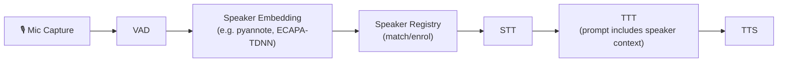

# 🏗️ MindMirror Architecture Review

## Package Layout Overview

```
src/mindmirror/
├── main.py              # Orchestrator: process spawning, composition
├── config.py            # Flat module-level config (env vars + constants)
├── audio/               # Hardware I/O, DSP, device selection
│   ├── devices.py       # Device enumeration, safe_open_stream
│   ├── dsp.py           # Noise reduction, highpass, trim, normalise
│   └── io.py            # Calibration, preroll buffer, clip recording
├── stt/                 # Speech-to-Text
│   ├── interface.py     # STTInterface ABC
│   ├── runner.py        # run_stt_loop (VAD + state machine + interruption)
│   ├── vad.py           # VADEngine (energy-based)
│   ├── google/          # Google Cloud STT V2 (streaming)
│   ├── local_whisper/   # Local Whisper (batch)
│   └── aws_whisper/     # SageMaker Whisper (batch)
├── llm/                 # Text-to-Thought (TTT)
│   ├── interface.py     # TTTInterface ABC
│   ├── runner.py        # run_ttt_loop (async, MCP, rate-limiting)
│   ├── google/          # Direct Gemini GenAI SDK client
│   └── langchain/       # LangChain + DeepAgents client
├── tts/                 # Text-to-Speech
│   ├── interface.py     # TTSInterface ABC
│   ├── runner.py        # run_tts_loop (thin: instantiate + delegate)
│   ├── utils.py         # File-based lock helpers
│   ├── elevenlabs/      # ElevenLabs streaming
│   ├── f5_tts/          # F5-TTS diffusion voice cloning
│   ├── google/          # Google Cloud TTS
│   └── pipervoice/      # Piper ONNX CPU synthesis
├── memory/              # Persistent vector memory
│   ├── chroma_store.py  # ChromaMemoryManager (ChromaDB)
│   └── tools.py         # LangChain StructuredTool wrappers
├── mcp_client/          # Model Context Protocol
│   ├── client.py        # MCPClientManager (stdio/SSE)
│   └── mock_server.py   # Mock MCP server for dev
└── ui/                  # Console output
    ├── console.py       # console_process (Rich log drain)
    └── meters.py        # Volume meter rendering
```

---

## 🟢 What's Working Well

| Area | Details |
|------|---------|
| **Strategy Pattern** | STT, TTT, TTS all have ABCs with concrete swappable implementations. Good. |
| **Process Isolation** | Each pipeline stage runs in its own `multiprocessing.Process`. Crashes are contained. |
| **Queue Decoupling** | `stt_queue`, `ttt_queue`, `control_queue`, `log_queue` — clean IPC boundaries. |
| **Streaming STT** | Google Cloud STT supports real-time chunk-by-chunk streaming via background thread. |
| **MCP Abstraction** | `MCPClientManager` is vendor-agnostic. Tools are discovered dynamically and routed by name. |
| **Memory Separation** | Runtime agent memory (`data/`) is cleanly separated from dev guidelines (root `AGENTS.md`). |

---

## 🔴 Bottlenecks & Architectural Issues

### 1. File-Based Locking Is a Race Condition Minefield

> [!CAUTION]
> [`tts/utils.py`](file:///home/mario/1_study/repository/mindmirror/src/mindmirror/tts/utils.py) uses `speaking.lock` and `playback.lock` **files on disk** to coordinate STT and TTS processes. [`stt/runner.py`](file:///home/mario/1_study/repository/mindmirror/src/mindmirror/stt/runner.py) polls `os.path.exists(PLAYBACK_LOCK)` every loop iteration.

**Problems:**
- **TOCTOU races**: The file can appear/disappear between the `exists()` check and the next line of code.
- **Stale locks on crash**: `clean_stale_locks()` exists in `main.py` but only runs at startup — a mid-session crash leaves orphaned locks.
- **Filesystem I/O latency**: On slower media or under load, file stat calls add measurable jitter to a loop that runs every ~100ms.
- **No atomicity**: Multiple processes can read/write the same file simultaneously.

**Fix:** Replace with `multiprocessing.Event` objects (or `multiprocessing.Value` for numeric state). They're shared-memory, atomic, and survive partial crashes via proper `finally` blocks. Pass them as arguments alongside the queues.

---

### 2. `run_stt_loop` Is a 220-Line God Function

> [!WARNING]
> [`stt/runner.py`](file:///home/mario/1_study/repository/mindmirror/src/mindmirror/stt/runner.py) mixes **six distinct responsibilities** in one function: audio capture, VAD, state machine, interruption detection, visualisation, and lock polling.

**Impact on speaker identification:** Adding speaker ID requires intercepting audio _before_ transcription. Right now there's no clean injection point — you'd have to hack it into the middle of the god function.

**Fix:** Decompose into a pipeline of composable stages:
```python
class AudioCapture:       # Reads chunks from sounddevice
class InterruptDetector:  # Monitors energy during playback
class VADStateMachine:    # Speech/silence transitions
class SpeakerIdentifier:  # NEW: Embedding extraction + clustering
class Transcriber:        # Delegates to STTInterface
```
Each stage reads from an input queue and writes to an output queue (or yields chunks). The runner becomes a thin wiring function.

---

### 3. `TTSInterface` Has the Wrong Abstraction Level

> [!WARNING]
> [`tts/interface.py`](file:///home/mario/1_study/repository/mindmirror/src/mindmirror/tts/interface.py) defines a single method `tts_task(log_queue, selected_device, text_queue, control_queue)` — it's essentially saying "run the entire TTS process yourself, here are raw multiprocessing primitives."

**Problems:**
- Every TTS implementation must independently re-implement the **playback loop**, **queue polling**, **volume control**, **interruption handling**, and **lock management**. Compare [`elevenlabs/tts.py`](file:///home/mario/1_study/repository/mindmirror/src/mindmirror/tts/elevenlabs/tts.py) (194 lines) with what should be a simple "text → audio bytes" call.
- Adding a new TTS backend (e.g., a local LLM TTS) requires copy-pasting ~150 lines of boilerplate.
- Testing a TTS engine in isolation is impossible because it's coupled to live audio hardware and multiprocessing queues.

**Fix:** Split into two layers:
```python
class TTSEngine(ABC):
    """Pure synthesis — no I/O."""
    @abstractmethod
    def synthesise(self, text: str, style: str) -> AudioSegment:  # or generator for streaming
        ...

class TTSPlaybackLoop:
    """Shared infrastructure: queue drain, volume, interruption, locks."""
    def __init__(self, engine: TTSEngine, ...): ...
    def run(self): ...
```
Now ElevenLabs only implements `synthesise()` (~30 lines), and you test it without `sounddevice`.

---

### 4. `TTTInterface` Doesn't Surface Streaming / Structured Output

> [!IMPORTANT]
> [`TTTInterface.send_message()`](file:///home/mario/1_study/repository/mindmirror/src/mindmirror/llm/interface.py#L18-L33) returns `str`. This means:
> - No streaming token delivery to TTS (you wait for the **entire** response before speaking).
> - Style tags are embedded in the string and parsed _after the fact_ by [`parse_llm_response()`](file:///home/mario/1_study/repository/mindmirror/src/mindmirror/llm/runner.py#L25-L31) — fragile regex on free-form LLM text.
> - No structured metadata channel for speaker ID, confidence, tool results, etc.

**Impact on local TTT:** A local model (llama.cpp, vLLM, Ollama) will _especially_ benefit from streaming since inference is slower. Without a streaming interface, you'll be staring at silence for the entire generation time.

**Fix:**
```python
class TTTResponse:
    style: str              # Parsed style tag
    text: str               # Clean spoken text
    metadata: dict          # speaker_id, confidence, tool_results, etc.

class TTTInterface(ABC):
    @abstractmethod
    async def send_message(self, text: str) -> TTTResponse: ...

    async def stream_message(self, text: str) -> AsyncIterator[TTTResponse]:
        """Default: yield the full response. Override for token streaming."""
        yield await self.send_message(text)
```

---

### 5. `config.py` Is a Flat God Module

> [!NOTE]
> [`config.py`](file:///home/mario/1_study/repository/mindmirror/src/mindmirror/config.py) is 163 lines of module-level constants covering **audio**, **DSP**, **VAD**, **STT**, **TTT**, **TTS** (×4 engines), **MCP**, **memory**, and **greeting** settings — all in one flat namespace.

**Problems:**
- Adding speaker ID config, local TTT config, embedding model config, etc., will bloat this further.
- No validation (typos in `.env` silently produce `None`).
- No way to runtime-override (everything is import-time frozen).
- Test fixtures can't substitute config without monkeypatching a module.

**Fix:** Use `pydantic.BaseSettings` (or `dataclasses` + `dacite`) grouped by domain:
```python
class AudioConfig(BaseSettings): ...
class STTConfig(BaseSettings): ...
class TTTConfig(BaseSettings): ...
class TTSConfig(BaseSettings): ...
class SpeakerIDConfig(BaseSettings): ...  # NEW

class MindMirrorConfig(BaseSettings):
    audio: AudioConfig
    stt: STTConfig
    ttt: TTTConfig
    ...
```
Inject the config object rather than importing a global module.

---

### 6. `run_ttt_loop` Has Google-Specific Error Handling

[`runner.py` L125](file:///home/mario/1_study/repository/mindmirror/src/mindmirror/llm/runner.py#L125) catches `google.api_core.exceptions.ResourceExhausted` directly. This leaks a vendor dependency into the _generic_ pipeline runner, which would break or be silently bypassed when you plug in a local TTT (Ollama, vLLM) or OpenAI.

**Fix:** Have each `TTTInterface` implementation raise a common `RateLimitError` (your own exception class). The runner catches only that.

---

### 7. System Prompt Is Hardcoded in `main.py`

> [!NOTE]
> The [`SYSTEM_PROMPT`](file:///home/mario/1_study/repository/mindmirror/src/mindmirror/main.py#L33-L62) lives as a Python string literal in `main.py`. Adding speaker-specific instructions ("The current speaker is Mario, whose preferences are...") requires modifying this string at runtime.

**Fix:** Move to a template-based approach:
- Base prompt lives in `data/prompts/system.md` (or as a config field).
- A `PromptBuilder` class merges the base prompt + speaker profile + active memories + skill triggers at runtime.
- The LLM runner calls `prompt_builder.build(speaker_id="mario")` before each invocation when the speaker changes.

---

### 8. No Pipeline Message Envelope

Currently the queues pass raw `str` (STT→TTT) and raw `tuple[str, str]` (TTT→TTS). There's no metadata carrier.

**Impact:** Speaker ID, timestamps, confidence scores, turn IDs, language detected — none of these can be threaded through the pipeline without changing every queue consumer.

**Fix:** Define a `PipelineMessage` dataclass:
```python
@dataclass
class PipelineMessage:
    text: str
    speaker_id: str | None = None
    style: str = "neutral"
    timestamp: float = field(default_factory=time.time)
    turn_id: str = field(default_factory=lambda: uuid4().hex[:8])
    metadata: dict = field(default_factory=dict)
```
All queues carry `PipelineMessage` instances. Each stage enriches the message and passes it on.

---

## 🔮 Impact Assessment for Planned Features

### A. Speaker Identification & Distinction

| Requirement | Current Support | Gap |
|-------------|----------------|-----|
| Extract speaker embedding from audio chunk | ❌ No embedding pipeline | Need a `SpeakerIdentifier` stage between VAD and STT |
| Cluster/match embeddings to known speakers | ❌ No speaker registry | Need a `SpeakerRegistry` (potentially backed by ChromaDB with a separate collection for voice embeddings) |
| Pass speaker ID to LLM | ❌ Queue carries raw `str` | Need `PipelineMessage` envelope |
| Per-speaker system prompt / memory recall | ❌ Prompt is static | Need `PromptBuilder` with speaker profiles |
| Store per-speaker preferences in memory | ⚠️ ChromaDB exists but no speaker partitioning | Add `speaker_id` metadata filter to `add_memory()` / `recall_memories()` |

**Recommended architecture for speaker ID:**



Where to slot it in:
1. **After VAD confirms speech, before STT transcribes** — extract embedding from the buffered utterance.
2. **SpeakerRegistry** matches the embedding against enrolled voices (cosine similarity on stored embeddings in ChromaDB or a simple in-memory dict).
3. **PipelineMessage** carries `speaker_id` downstream so the LLM runner can inject speaker-specific context.

### B. Local TTT (Ollama / llama.cpp / vLLM)

| Requirement | Current Support | Gap |
|-------------|----------------|-----|
| Plug in a local inference backend | ⚠️ `TTTInterface` exists | But `runner.py` catches Google-specific exceptions |
| Streaming token output | ❌ `send_message()` returns `str` | Need `stream_message()` on the interface |
| Tool calling with local models | ⚠️ LangChain has some support | DeepAgents coupling may conflict; need to verify tool-call support per backend |
| GPU memory sharing with STT/TTS | ❌ No GPU resource coordination | Multiprocessing means separate CUDA contexts — careful with VRAM budgets |

**Recommended approach:**
1. Add `OllamaLLMClient(TTTInterface)` in `llm/ollama/client.py`.
2. Implement `stream_message()` yielding `TTTResponse` chunks.
3. Adapt `run_ttt_loop` to consume the async iterator and push `PipelineMessage` segments to TTS incrementally.

### C. Multi-Speaker Memory via LLM System Prompt

Current memory is speaker-agnostic. To make it speaker-aware:

1. **ChromaDB metadata**: Add `speaker_id` field to every stored memory.
2. **recall_memories filter**: `recall_memories(query, speaker_id=None)` filters by speaker when provided.
3. **PromptBuilder**: On each turn, prepend relevant speaker memories to the system prompt:
   ```
   Current speaker: Mario
   Known preferences: [recalled from ChromaDB filtered by speaker_id="mario"]
   ```

---

## 📋 Prioritised Improvement Roadmap

| Priority | Change | Effort | Impact |
|----------|--------|--------|--------|
| 🔴 **P0** | Replace file locks with `multiprocessing.Event` | Small | Eliminates race conditions, improves latency |
| 🔴 **P0** | Introduce `PipelineMessage` envelope dataclass | Small | Unblocks speaker ID, timestamps, metadata threading |
| 🟠 **P1** | Refactor `TTSInterface` → `TTSEngine` + shared `PlaybackLoop` | Medium | Eliminates ~500 lines of duplicated boilerplate across 4 TTS impls |
| 🟠 **P1** | Add `stream_message()` to `TTTInterface` | Medium | Unblocks local TTT and reduces time-to-first-audio |
| 🟠 **P1** | Decompose `run_stt_loop` into composable stages | Medium | Creates clean injection point for speaker ID |
| 🟡 **P2** | Replace vendor-specific exception handling in TTT runner | Small | Enables local TTT without silent error swallowing |
| 🟡 **P2** | Move config to `pydantic.BaseSettings` | Medium | Validation, grouping, testability, runtime overrides |
| 🟡 **P2** | Template-based system prompt (`PromptBuilder`) | Small | Enables per-speaker context injection |
| 🟢 **P3** | Speaker identification pipeline (embedding + registry) | Large | Core new feature |
| 🟢 **P3** | Local TTT implementation (Ollama/vLLM) | Medium | Core new feature |
| 🟢 **P3** | Speaker-partitioned memory in ChromaDB | Small | Enhances personalisation |

---

## 🧬 Suggested Package Layout (Post-Refactor)

```
src/mindmirror/
├── main.py
├── config/
│   ├── __init__.py          # MindMirrorConfig (pydantic)
│   ├── audio.py             # AudioConfig, DSPConfig, VADConfig
│   ├── stt.py               # STTConfig
│   ├── ttt.py               # TTTConfig
│   ├── tts.py               # TTSConfig
│   └── speaker.py           # SpeakerIDConfig
├── pipeline/
│   ├── message.py           # PipelineMessage dataclass
│   ├── events.py            # Shared multiprocessing.Event wrappers
│   └── exceptions.py        # RateLimitError, PipelineError, etc.
├── audio/                   # (unchanged)
├── stt/
│   ├── interface.py
│   ├── runner.py             # Thin wiring of composable stages
│   ├── capture.py            # AudioCapture stage
│   ├── vad.py                # VADStateMachine stage
│   ├── google/ ...
│   ├── local_whisper/ ...
│   └── aws_whisper/ ...
├── speaker/                  # NEW
│   ├── identifier.py         # SpeakerIdentifier (embedding extraction)
│   ├── registry.py           # SpeakerRegistry (match/enrol/profiles)
│   └── embeddings.py         # Voice embedding model wrappers
├── llm/
│   ├── interface.py          # TTTInterface + TTTResponse + stream_message()
│   ├── runner.py             # Generic runner (no vendor exceptions)
│   ├── prompt_builder.py     # NEW: Template-based prompt composition
│   ├── google/ ...
│   ├── langchain/ ...
│   └── ollama/               # NEW: Local TTT
│       └── client.py
├── tts/
│   ├── engine.py             # TTSEngine ABC (pure synthesis)
│   ├── playback.py           # Shared PlaybackLoop (queue, volume, locks)
│   ├── elevenlabs/ ...
│   ├── f5_tts/ ...
│   ├── google/ ...
│   └── pipervoice/ ...
├── memory/                   # + speaker_id partitioning
├── mcp_client/
└── ui/
```

---

> [!TIP]
> The P0 changes (file locks → Events, PipelineMessage) are small, non-breaking, and immediately unblock the speaker ID and local TTT features. I'd start there, mate.
