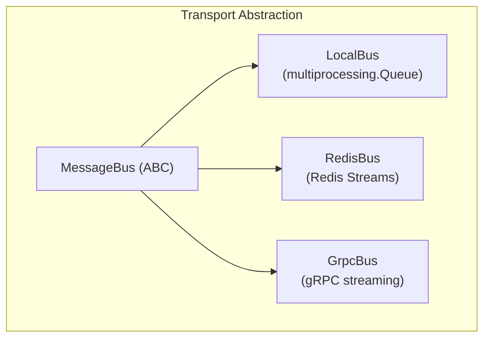
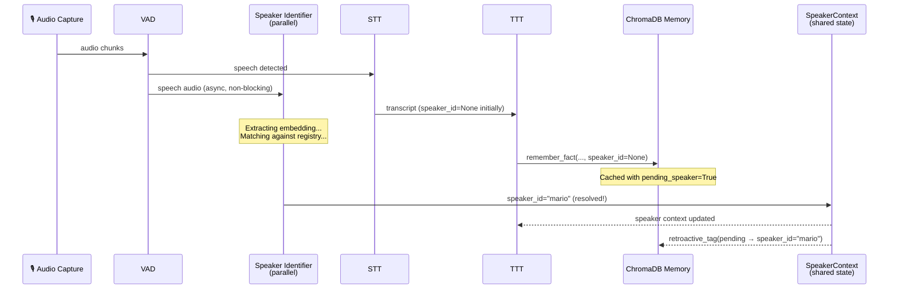
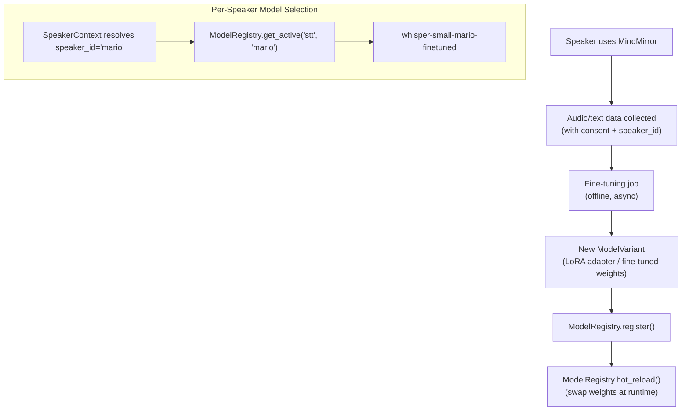
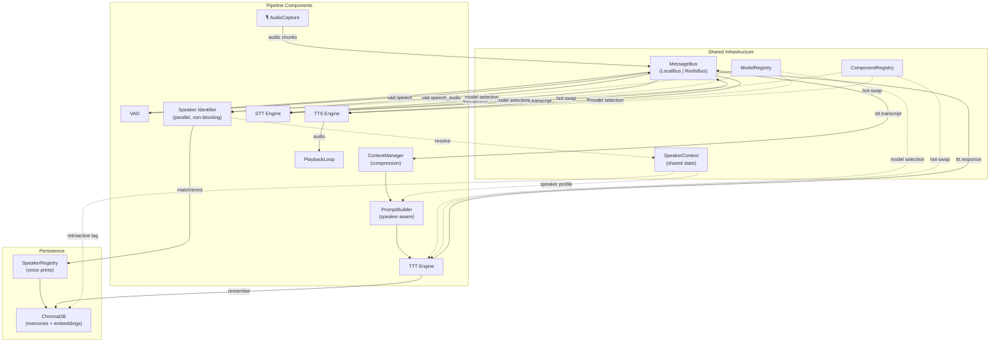

# 🏗️ MindMirror Architecture Review — v2 (Revised)

Builds on the [original review](file:///home/mario/.gemini/antigravity-ide/brain/a9fc5123-8961-4061-b1e7-e92cf69dd33c/architecture_review.md) with additional considerations for:
- Containerisation & hot-swappable components
- Context window management & compression
- Transparent background speaker identification
- Speaker ID as a parallel shared resource
- Openness to per-speaker fine-tuning

---

## 1. Containerisation & Hot-Swappable Components

### The Core Tension

The current architecture uses `multiprocessing.Process` + `multiprocessing.Queue`. This is fast and simple for a single-machine deployment, but:
- Queues are shared-memory — they **don't cross container boundaries**.
- Swapping a component means killing and respawning a process — no graceful hot-swap.
- No health checks, no independent scaling, no component versioning.

### Revised Approach: Abstract the Transport Layer

Don't go full microservices (that's overkill for a voice assistant), but **decouple the IPC mechanism** so you can run locally _or_ containerised with the same component code.



```python
# pipeline/transport.py

class MessageBus(ABC):
    """Abstract transport — components only see this interface."""

    @abstractmethod
    async def publish(self, channel: str, message: PipelineMessage) -> None: ...

    @abstractmethod
    async def subscribe(self, channel: str) -> AsyncIterator[PipelineMessage]: ...

    @abstractmethod
    async def request(self, channel: str, message: PipelineMessage,
                      timeout: float = 5.0) -> PipelineMessage: ...
    """For request/reply patterns (e.g., STT asking SpeakerContext for current ID)."""


class LocalBus(MessageBus):
    """multiprocessing.Queue wrapper — zero-config local deployment."""
    ...

class RedisBus(MessageBus):
    """Redis Streams — containerised deployment, persistence, replay."""
    ...
```

**Key design point:** Each pipeline component receives a `MessageBus` and channel names — it never knows whether it's talking to a local queue or a Redis stream. This means you can run everything in one process for dev, or one container per component in prod, with zero code changes.

### Hot-Swap via Component Registry

```python
# pipeline/registry.py

class ComponentRegistry:
    """Runtime registry for swappable pipeline components."""

    def __init__(self, bus: MessageBus):
        self.bus = bus
        self._components: dict[str, ComponentHandle] = {}

    async def register(self, name: str, component: PipelineComponent,
                       config: ComponentConfig) -> None:
        """Register and start a component."""
        handle = ComponentHandle(component, config, status="starting")
        self._components[name] = handle
        await component.start(self.bus)
        handle.status = "running"

    async def hot_swap(self, name: str, new_component: PipelineComponent,
                       new_config: ComponentConfig) -> None:
        """Swap a running component with zero pipeline downtime."""
        old = self._components[name]

        # 1. Start new component (it begins consuming from the bus)
        new_handle = ComponentHandle(new_component, new_config, status="starting")
        await new_component.start(self.bus)
        new_handle.status = "running"

        # 2. Drain old component gracefully
        await old.component.drain()
        await old.component.stop()

        # 3. Swap the reference
        self._components[name] = new_handle

    async def health_check(self, name: str) -> ComponentHealth: ...

    def get(self, name: str) -> ComponentHandle: ...
```

**Use case:** You're running ElevenLabs TTS, and you want to switch to local F5-TTS mid-conversation. The registry starts F5, waits for it to be ready, drains the ElevenLabs queue, then swaps. The pipeline never stops.

### PipelineComponent Base Class

Every STT/TTT/TTS/SpeakerID component implements this:

```python
class PipelineComponent(ABC):
    """Base for all pipeline-stage components."""

    @abstractmethod
    async def start(self, bus: MessageBus) -> None:
        """Subscribe to input channels, begin processing."""
        ...

    async def drain(self) -> None:
        """Process remaining in-flight messages before shutdown."""
        ...

    async def stop(self) -> None:
        """Release resources (models, connections, GPU memory)."""
        ...

    def health(self) -> ComponentHealth:
        return ComponentHealth(status="healthy")
```

### Containerisation Strategy

| Deployment Mode | Transport | Components | When |
|----------------|-----------|------------|------|
| **Local dev** | `LocalBus` (multiprocessing) | All in one process | Development, testing |
| **Local prod** | `LocalBus` | Separate processes | Single-machine deployment |
| **Container** | `RedisBus` or `GrpcBus` | One container per component | Multi-machine, scaling, or GPU isolation |

> [!TIP]
> You don't need to build all three buses on day one. Start with `LocalBus`, design to the `MessageBus` ABC, and add `RedisBus` later when you actually need containers. The abstraction costs almost nothing.

---

## 2. Context Window Management & Compression

### The Problem

- Cloud LLMs (Gemini 2.5 Flash) have massive context windows (~1M tokens) — but you're still paying per token.
- Local LLMs (Llama 3, Mistral via Ollama) typically have 4k–32k context windows.
- Long voice conversations accumulate history fast. Tool call results (MCP) can be verbose.
- Some conversations span hours. Without compression, you'll hit limits or burn through budget.

### ContextManager — Pluggable Compression

```python
# llm/context/manager.py

class ContextManager:
    """Manages conversation history with pluggable compression strategies."""

    def __init__(self, strategy: CompressionStrategy, max_tokens: int,
                 tokeniser: Tokeniser | None = None):
        self.strategy = strategy
        self.max_tokens = max_tokens
        self.tokeniser = tokeniser or TiktokenTokeniser()
        self.messages: list[PipelineMessage] = []
        self.compressed_summary: str | None = None

    def add_message(self, msg: PipelineMessage) -> None:
        self.messages.append(msg)

    async def get_context(self, system_prompt: str) -> list[dict]:
        """Returns the optimised message history for the next LLM call."""
        total_tokens = self._count_tokens(self.messages)

        if total_tokens <= self.max_tokens:
            return self._format(self.messages)

        # Apply compression strategy
        compressed = await self.strategy.compress(
            messages=self.messages,
            max_tokens=self.max_tokens,
            existing_summary=self.compressed_summary
        )
        self.messages = compressed.retained_messages
        self.compressed_summary = compressed.summary
        return self._format_with_summary(compressed)
```

### Compression Strategies

```python
class CompressionStrategy(ABC):
    @abstractmethod
    async def compress(self, messages, max_tokens, existing_summary) -> CompressedContext: ...

class SlidingWindowStrategy(CompressionStrategy):
    """Keep the N most recent messages. Simple, no LLM calls needed."""
    ...

class SummarisationStrategy(CompressionStrategy):
    """Summarise older messages via LLM, keep recent ones verbatim."""

    def __init__(self, summariser_llm: TTTInterface):
        self.summariser = summariser_llm  # Can be a cheap/fast model

    async def compress(self, messages, max_tokens, existing_summary):
        # Split: [old messages to summarise] + [recent messages to keep]
        split_point = self._find_split(messages, max_tokens)
        old = messages[:split_point]
        recent = messages[split_point:]

        # Generate summary of old messages (merge with existing summary)
        summary_prompt = self._build_summary_prompt(old, existing_summary)
        summary = await self.summariser.send_message(summary_prompt)

        return CompressedContext(
            summary=summary.text,
            retained_messages=recent
        )

class HierarchicalStrategy(CompressionStrategy):
    """Multi-tier: verbatim recent + summarised middle + ultra-compressed old."""
    ...

class TokenBudgetStrategy(CompressionStrategy):
    """Allocates token budgets: X% system prompt, Y% summary, Z% recent turns."""
    ...
```

### Integration with TTT Runner

```python
# In the TTT runner loop:
context_manager = ContextManager(
    strategy=SummarisationStrategy(summariser_llm=cheap_model),
    max_tokens=model_config.context_window - 2000  # Reserve for response
)

# Each turn:
context_manager.add_message(user_message)
context = await context_manager.get_context(system_prompt)
response = await llm_client.send_message_with_context(context)
context_manager.add_message(response)
```

> [!IMPORTANT]
> The `ContextManager` should be aware of `speaker_id` — when speakers change mid-conversation, you might want to compress the _other_ speaker's context more aggressively and keep the current speaker's recent history intact.

---

## 3. Transparent Background Speaker Identification

### Design Philosophy

Speaker ID should be **eventually consistent** and **non-blocking**. The pipeline never waits for it. It runs in parallel, and when it resolves, it retroactively enriches all cached data.



### SpeakerContext — Shared Parallel State

```python
# speaker/context.py

class SpeakerContext:
    """Shared, process-safe speaker state. Read by all components, written by SpeakerIdentifier."""

    def __init__(self, bus: MessageBus):
        self.bus = bus
        self._current_speaker: Value = Value('i', -1)  # or shared dict
        self._confidence: Value = Value('d', 0.0)
        self._speaker_profiles: dict[str, SpeakerProfile] = {}
        self._pending_items: list[PendingItem] = []  # Items awaiting speaker attribution
        self._lock = Lock()

    @property
    def current_speaker_id(self) -> str | None:
        sid = self._current_speaker.value
        return self._id_map.get(sid) if sid >= 0 else None

    @property
    def confidence(self) -> float:
        return self._confidence.value

    def get_profile(self, speaker_id: str) -> SpeakerProfile | None:
        return self._speaker_profiles.get(speaker_id)

    async def resolve_speaker(self, speaker_id: str, confidence: float) -> None:
        """Called by SpeakerIdentifier when identification succeeds."""
        with self._lock:
            self._current_speaker.value = self._resolve_id(speaker_id)
            self._confidence.value = confidence

        # Retroactively tag all pending items
        await self._flush_pending(speaker_id)

        # Broadcast to all components via bus
        await self.bus.publish("speaker.resolved", PipelineMessage(
            text="",
            speaker_id=speaker_id,
            metadata={"confidence": confidence, "event": "speaker_resolved"}
        ))

    async def cache_pending(self, item: PendingItem) -> None:
        """Cache a memory/data item until speaker is identified."""
        with self._lock:
            if self.current_speaker_id:
                # Speaker already known — tag immediately
                item.speaker_id = self.current_speaker_id
                await self._store_item(item)
            else:
                # Cache for retroactive tagging
                self._pending_items.append(item)

    async def _flush_pending(self, speaker_id: str) -> None:
        """Retroactively tag all cached items with the resolved speaker ID."""
        items_to_flush = []
        with self._lock:
            items_to_flush = self._pending_items.copy()
            self._pending_items.clear()

        for item in items_to_flush:
            item.speaker_id = speaker_id
            await self._store_item(item)
```

### SpeakerIdentifier — The Parallel Component

```python
# speaker/identifier.py

class SpeakerIdentifier(PipelineComponent):
    """Runs in parallel. Extracts voice embeddings, matches against registry."""

    def __init__(self, embedding_model: EmbeddingModel,
                 registry: SpeakerRegistry,
                 context: SpeakerContext,
                 config: SpeakerIDConfig):
        self.embedding_model = embedding_model
        self.registry = registry
        self.context = context
        self.config = config
        self._embedding_buffer: list[np.ndarray] = []

    async def start(self, bus: MessageBus) -> None:
        # Subscribe to audio chunks from VAD
        async for msg in bus.subscribe("vad.speech_audio"):
            audio = msg.metadata["audio_data"]
            await self._process_audio(audio)

    async def _process_audio(self, audio: np.ndarray) -> None:
        # 1. Extract embedding
        embedding = self.embedding_model.extract(audio)
        self._embedding_buffer.append(embedding)

        # 2. Aggregate embeddings for stability (e.g., average last N)
        if len(self._embedding_buffer) < self.config.min_utterances_for_id:
            return  # Not enough data yet

        aggregated = np.mean(self._embedding_buffer[-self.config.window_size:], axis=0)

        # 3. Match against registry
        match = self.registry.match(aggregated, threshold=self.config.similarity_threshold)

        if match:
            await self.context.resolve_speaker(match.speaker_id, match.confidence)
            self._embedding_buffer.clear()
        elif len(self._embedding_buffer) > self.config.max_unmatched_utterances:
            # Unknown speaker — optionally enrol as new
            if self.config.auto_enrol:
                new_id = await self.registry.enrol(aggregated)
                await self.context.resolve_speaker(new_id, confidence=0.5)
            self._embedding_buffer.clear()
```

### SpeakerRegistry — Voice Embedding Store

```python
# speaker/registry.py

class SpeakerRegistry:
    """Persistent speaker voice print store. Backed by ChromaDB (separate collection)."""

    def __init__(self, chroma_client, collection_name: str = "speaker_embeddings"):
        self.collection = chroma_client.get_or_create_collection(collection_name)

    def match(self, embedding: np.ndarray, threshold: float = 0.7) -> SpeakerMatch | None:
        """Cosine similarity search against enrolled voice prints."""
        results = self.collection.query(
            query_embeddings=[embedding.tolist()],
            n_results=1
        )
        if results and results['distances'][0][0] < (1 - threshold):
            return SpeakerMatch(
                speaker_id=results['ids'][0][0],
                confidence=1 - results['distances'][0][0]
            )
        return None

    async def enrol(self, embedding: np.ndarray,
                    speaker_id: str | None = None,
                    profile: SpeakerProfile | None = None) -> str:
        """Enrol a new speaker or update an existing voice print."""
        sid = speaker_id or f"speaker_{uuid4().hex[:8]}"
        self.collection.upsert(
            ids=[sid],
            embeddings=[embedding.tolist()],
            metadatas=[profile.to_dict() if profile else {}]
        )
        return sid

    async def update_embedding(self, speaker_id: str, new_embedding: np.ndarray,
                               momentum: float = 0.9) -> None:
        """Incrementally update a speaker's voice print (adaptation over time)."""
        existing = self.collection.get(ids=[speaker_id], include=["embeddings"])
        if existing['embeddings']:
            old = np.array(existing['embeddings'][0])
            updated = momentum * old + (1 - momentum) * new_embedding
            updated = updated / np.linalg.norm(updated)  # Re-normalise
            self.collection.update(ids=[speaker_id], embeddings=[updated.tolist()])
```

### How Every Component Accesses Speaker ID

Each component reads from `SpeakerContext` — it's advisory, never blocking:

| Component | How it uses `SpeakerContext` |
|-----------|---------------------------|
| **STT** | Tags `PipelineMessage.speaker_id` if available; `None` otherwise |
| **TTT** | `PromptBuilder` injects speaker profile into system prompt when `speaker_id` is set |
| **TTS** | Could select per-speaker voice/style preferences |
| **Memory** | `cache_pending()` if no speaker; direct `add_memory(speaker_id=...)` if resolved |
| **ContextManager** | Per-speaker compression; keeps current speaker's history higher-priority |

---

## 4. Context-Aware Memory with Retroactive Speaker Tagging

### Enhanced ChromaMemoryManager

```python
class ChromaMemoryManager:
    """Extended with speaker-aware storage and retroactive tagging."""

    def add_memory(self, fact: str, category: str = "general",
                   speaker_id: str | None = None,
                   pending_speaker: bool = False,
                   metadata: dict | None = None) -> str:
        meta = {
            "timestamp": time.strftime("%Y-%m-%d %H:%M:%S"),
            "category": category,
            "speaker_id": speaker_id or "unknown",
            "pending_speaker": pending_speaker,  # Flag for retroactive tagging
        }
        if metadata:
            meta.update(metadata)
        # ... store as before

    def recall_memories(self, query: str, speaker_id: str | None = None,
                        limit: int = 5) -> list[dict]:
        """Optionally filter by speaker_id."""
        where_filter = None
        if speaker_id:
            where_filter = {"speaker_id": speaker_id}
        # ... query with where_filter

    def retroactive_tag(self, speaker_id: str) -> int:
        """Tag all pending (unattributed) memories with the resolved speaker_id."""
        pending = self.collection.get(
            where={"pending_speaker": True}
        )
        if pending and pending['ids']:
            self.collection.update(
                ids=pending['ids'],
                metadatas=[{**m, "speaker_id": speaker_id, "pending_speaker": False}
                           for m in pending['metadatas']]
            )
            return len(pending['ids'])
        return 0
```

---

## 5. Fine-Tuning Openness — ModelRegistry

The architecture should let users fine-tune or swap model weights per component, per speaker, at runtime.

### ModelRegistry

```python
# pipeline/model_registry.py

@dataclass
class ModelVariant:
    model_id: str                 # e.g., "whisper-small-mario-finetuned"
    base_model: str               # e.g., "openai/whisper-small"
    weights_path: Path | None     # Local path to weights/LoRA adapters
    speaker_id: str | None        # None = universal, "mario" = speaker-specific
    component: str                # "stt", "ttt", "tts", "speaker_id"
    metadata: dict = field(default_factory=dict)  # Training metrics, date, etc.

class ModelRegistry:
    """Tracks available model variants per component, supports per-speaker overrides."""

    def __init__(self, registry_path: Path):
        self.registry_path = registry_path
        self._variants: dict[str, list[ModelVariant]] = defaultdict(list)

    def register(self, variant: ModelVariant) -> None: ...

    def get_active(self, component: str,
                   speaker_id: str | None = None) -> ModelVariant:
        """Returns the best model for this component + speaker combo.
        Priority: speaker-specific fine-tuned > universal fine-tuned > base model."""
        candidates = self._variants[component]
        if speaker_id:
            speaker_specific = [v for v in candidates if v.speaker_id == speaker_id]
            if speaker_specific:
                return speaker_specific[-1]  # Latest
        universal = [v for v in candidates if v.speaker_id is None]
        return universal[-1] if universal else self._default(component)

    async def hot_reload(self, component: str, variant: ModelVariant,
                         registry: ComponentRegistry) -> None:
        """Load new weights into a running component (hot-swap the model, not the component)."""
        handle = registry.get(component)
        await handle.component.load_model(variant)
```

### How Fine-Tuning Fits



**Concrete examples:**
- STT: Fine-tune Whisper on Mario's accent → better transcription accuracy.
- TTT: LoRA adapter trained on Mario's conversational style.
- TTS: F5-TTS fine-tuned on Mario's voice samples → clone voice.
- Speaker ID: Update voice embeddings over time (the `update_embedding` with momentum above).

Each component's interface gains an optional `load_model(variant)` method:

```python
class PipelineComponent(ABC):
    # ... existing methods ...

    async def load_model(self, variant: ModelVariant) -> None:
        """Hot-reload model weights. Default: restart required."""
        raise NotImplementedError("This component does not support hot model reload.")
```

---

## 6. Revised Pipeline Architecture (Full Picture)



---

## 7. Revised `PipelineMessage` (Enriched Envelope)

```python
@dataclass
class PipelineMessage:
    text: str
    speaker_id: str | None = None          # None = not yet resolved
    speaker_confidence: float = 0.0
    style: str = "neutral"
    channel: str = ""                       # Routing: "stt.transcript", "ttt.response", etc.
    timestamp: float = field(default_factory=time.time)
    turn_id: str = field(default_factory=lambda: uuid4().hex[:8])
    session_id: str = ""                    # Conversation session
    metadata: dict = field(default_factory=dict)
    # metadata can carry: audio_data, embeddings, token_count, model_variant, etc.

    def with_speaker(self, speaker_id: str, confidence: float) -> "PipelineMessage":
        """Return enriched copy with speaker info (immutable pattern)."""
        return replace(self, speaker_id=speaker_id, speaker_confidence=confidence)
```

---

## 8. Changes to the Original Review's Recommendations

| Original Recommendation | Revision |
|------------------------|----------|
| Replace file locks with `multiprocessing.Event` | ✅ Still correct for `LocalBus`. For `RedisBus`, use Redis pub/sub signals instead. Either way, the `MessageBus` abstraction hides the mechanism. |
| Decompose `run_stt_loop` into composable stages | ✅ Even more important now. Each stage becomes a `PipelineComponent` that plugs into the `MessageBus`. SpeakerIdentifier slots in naturally as a parallel subscriber. |
| Refactor `TTSInterface` → `TTSEngine` + `PlaybackLoop` | ✅ `TTSEngine` becomes a `PipelineComponent`. `PlaybackLoop` is a separate component subscribing to TTS output. |
| Add `stream_message()` to `TTTInterface` | ✅ Critical for local TTT. Stream tokens into the `ContextManager` and `MessageBus` simultaneously. |
| Move config to `pydantic.BaseSettings` | ✅ Now grouped by component, each `PipelineComponent` receives its own typed config. |
| Template-based `PromptBuilder` | ✅ Extended: `PromptBuilder` now consults `SpeakerContext` + `ContextManager` + `ModelRegistry` to compose prompts. |
| **NEW:** `MessageBus` transport abstraction | Enables containerisation without code changes. |
| **NEW:** `ComponentRegistry` + hot-swap | Runtime component replacement. |
| **NEW:** `ContextManager` with compression strategies | Handles context limits for local TTT and cost control for cloud. |
| **NEW:** `SpeakerContext` as parallel shared state | Non-blocking speaker ID with retroactive tagging. |
| **NEW:** `ModelRegistry` for fine-tuning | Per-speaker model management and hot-reload. |

---

## 9. Revised Prioritised Roadmap

| Priority | Change | Effort | Unblocks |
|----------|--------|--------|----------|
| 🔴 **P0** | `PipelineMessage` envelope | Small | Everything. Every other change depends on having structured messages. |
| 🔴 **P0** | `MessageBus` ABC + `LocalBus` impl | Medium | Hot-swap, containerisation, speaker ID parallelism. Replace file locks at the same time. |
| 🔴 **P0** | `PipelineComponent` base class | Small | Component registry, hot-swap, fine-tuning interface. |
| 🟠 **P1** | `SpeakerContext` + retroactive tagging | Medium | Speaker-aware memory, prompt building, per-speaker models. |
| 🟠 **P1** | Decompose `run_stt_loop` → `AudioCapture` + `VAD` + `Transcriber` components | Medium | Clean injection point for `SpeakerIdentifier`. |
| 🟠 **P1** | `TTSEngine` + `PlaybackLoop` split | Medium | Testable TTS, reduced boilerplate, hot-swap of TTS engines. |
| 🟠 **P1** | `stream_message()` on `TTTInterface` | Medium | Local TTT, reduced time-to-first-audio. |
| 🟡 **P2** | `ContextManager` + `SlidingWindowStrategy` | Medium | Local TTT with small context windows. |
| 🟡 **P2** | `SummarisationStrategy` for compression | Medium | Long conversations, cost control. |
| 🟡 **P2** | `ComponentRegistry` + hot-swap | Medium | Runtime component replacement. |
| 🟡 **P2** | `PromptBuilder` (speaker-aware) | Small | Dynamic prompts, per-speaker context injection. |
| 🟡 **P2** | `ModelRegistry` + `ModelVariant` | Medium | Per-speaker models, fine-tuning workflow. |
| 🟢 **P3** | `SpeakerIdentifier` component (embedding model) | Large | Core speaker ID feature. |
| 🟢 **P3** | `SpeakerRegistry` (ChromaDB voice prints) | Medium | Speaker enrolment, matching. |
| 🟢 **P3** | Local TTT component (`OllamaLLMClient`) | Medium | Offline/local inference. |
| 🟢 **P3** | `RedisBus` implementation | Medium | Container deployment. |
| 🟢 **P3** | Fine-tuning pipeline (data collection + training) | Large | Per-speaker model customisation. |
| ⚪ **P4** | `GrpcBus` implementation | Medium | High-performance container deployment. |
| ⚪ **P4** | Auto-scaling per component | Large | Production scaling. |

---

## 10. Revised Package Layout

```
src/mindmirror/
├── main.py                       # Thin: reads config, wires registry, starts bus
├── config/
│   ├── __init__.py               # MindMirrorConfig (pydantic BaseSettings)
│   ├── audio.py
│   ├── stt.py
│   ├── ttt.py
│   ├── tts.py
│   └── speaker.py
├── pipeline/
│   ├── message.py                # PipelineMessage dataclass
│   ├── component.py              # PipelineComponent ABC
│   ├── transport/
│   │   ├── __init__.py           # MessageBus ABC
│   │   ├── local.py              # LocalBus (multiprocessing)
│   │   └── redis.py              # RedisBus (future)
│   ├── registry.py               # ComponentRegistry (hot-swap)
│   ├── model_registry.py         # ModelRegistry + ModelVariant
│   └── exceptions.py             # RateLimitError, PipelineError, etc.
├── audio/
│   ├── capture.py                # AudioCapture component
│   ├── playback.py               # PlaybackLoop component
│   ├── devices.py
│   ├── dsp.py
│   └── io.py
├── stt/
│   ├── interface.py              # STTEngine ABC (pure transcription)
│   ├── component.py              # STT PipelineComponent (wiring)
│   ├── vad.py                    # VAD PipelineComponent
│   ├── google/ ...
│   ├── local_whisper/ ...
│   └── aws_whisper/ ...
├── speaker/
│   ├── context.py                # SpeakerContext (shared state)
│   ├── identifier.py             # SpeakerIdentifier component
│   ├── registry.py               # SpeakerRegistry (ChromaDB voice prints)
│   └── embeddings/
│       ├── interface.py          # EmbeddingModel ABC
│       ├── pyannote.py           # pyannote/embedding
│       └── ecapa.py              # ECAPA-TDNN
├── llm/
│   ├── interface.py              # TTTInterface + TTTResponse + stream_message()
│   ├── component.py              # TTT PipelineComponent (wiring)
│   ├── context/
│   │   ├── manager.py            # ContextManager
│   │   ├── strategies.py         # Compression strategies
│   │   └── tokeniser.py          # Token counting
│   ├── prompt_builder.py         # Speaker-aware prompt composition
│   ├── google/ ...
│   ├── langchain/ ...
│   └── ollama/                   # Local TTT
│       └── client.py
├── tts/
│   ├── engine.py                 # TTSEngine ABC (pure synthesis)
│   ├── component.py              # TTS PipelineComponent (wiring)
│   ├── elevenlabs/ ...
│   ├── f5_tts/ ...
│   ├── google/ ...
│   └── pipervoice/ ...
├── memory/
│   ├── chroma_store.py           # + speaker_id filtering + retroactive tagging
│   └── tools.py                  # + speaker-aware tool wrappers
├── mcp_client/ ...
└── ui/ ...
```

> [!TIP]
> The key structural change from v1 is the `pipeline/` package. It's the nervous system — `MessageBus`, `PipelineComponent`, `ComponentRegistry`, `ModelRegistry`. Every other package plugs into it. Start there.
