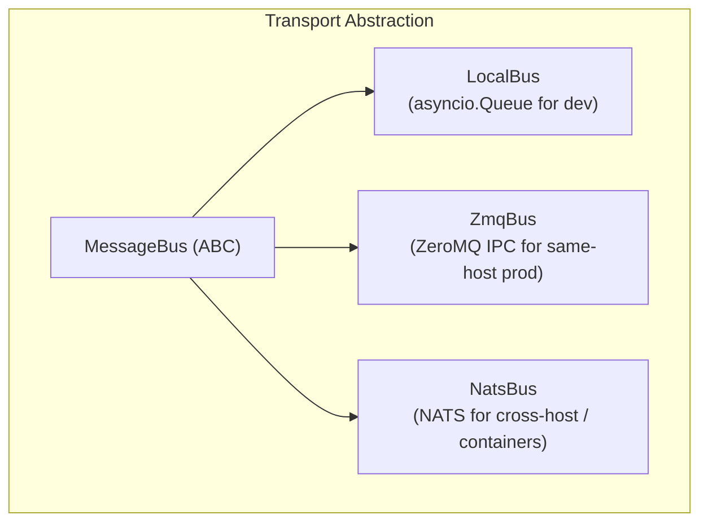
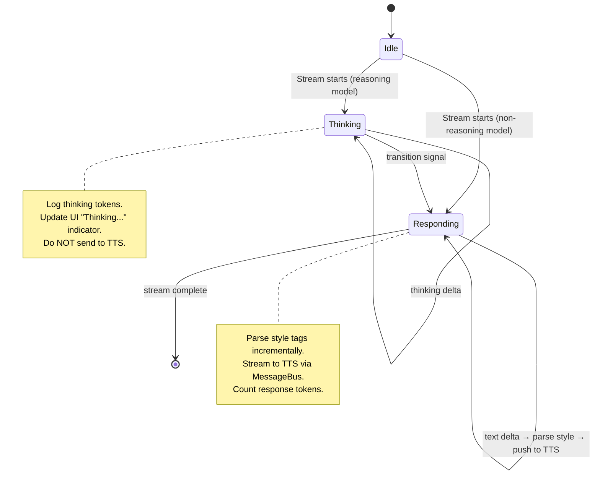

# 🏗️ MindMirror Architecture Review — v3 (Corrected)

Corrections from v2 based on your feedback + research into what real-time voice AI systems actually use.

> [!NOTE]
> This builds on [v1](file:///home/mario/.gemini/antigravity-ide/brain/a9fc5123-8961-4061-b1e7-e92cf69dd33c/architecture_review.md) (original review) and [v2](file:///home/mario/.gemini/antigravity-ide/brain/a9fc5123-8961-4061-b1e7-e92cf69dd33c/architecture_review_v2.md) (containerisation + speaker ID). This document focuses only on what **changed or was added** — the rest of v2 still stands.

---

## 1. "Fine-Tuning" → Per-Speaker Parameter Profiles

You're right — I massively over-scoped this. You don't want model weight fine-tuning (LoRA, adapters). You want **per-speaker runtime parameter tuning**: VAD thresholds, TTS voice settings, tone/pitch preferences, STT language hints, style tag biases.

This is a config layer problem, not a training pipeline problem.

### SpeakerProfile — The Parameter Store

```python
# speaker/profile.py

@dataclass
class SpeakerProfile:
    """Per-speaker parameter overrides. Stored in ChromaDB alongside voice embeddings."""

    speaker_id: str
    display_name: str = ""

    # VAD overrides
    vad_speech_threshold_multiplier: float | None = None    # Override config default
    vad_silence_duration: float | None = None               # How long to wait before end-of-utterance
    vad_min_audio_length: float | None = None

    # STT overrides
    stt_language_code: str | None = None                    # e.g., "en-GB" vs "de-DE"
    stt_model_hint: str | None = None                       # e.g., "latest_long" vs "telephony"

    # TTT overrides
    ttt_temperature: float | None = None
    ttt_reasoning_effort: str | None = None                 # "low", "medium", "high"
    ttt_style_bias: str | None = None                       # Default style if model forgets tag

    # TTS overrides
    tts_voice_id: str | None = None                         # Per-speaker voice selection
    tts_speaking_rate: float | None = None
    tts_pitch: float | None = None
    tts_style_overrides: dict[str, dict] | None = None      # Per-style param tweaks

    # Prompt overrides
    prompt_context: str | None = None                       # Extra context injected into system prompt
    # e.g., "Mario is a software engineer interested in AI/ML and cybersecurity."

    # Metadata
    created_at: str = ""
    updated_at: str = ""

    def merge_with_defaults(self, defaults: "MindMirrorConfig") -> "ResolvedConfig":
        """Overlay speaker-specific values onto global defaults.
        None means 'use the default'."""
        return ResolvedConfig(
            vad_speech_threshold_multiplier=(
                self.vad_speech_threshold_multiplier
                or defaults.vad.speech_threshold_multiplier
            ),
            # ... same pattern for all fields
        )
```

### Where Profiles Live

Profiles are stored in the same ChromaDB instance, in a dedicated collection (alongside voice embeddings in the `SpeakerRegistry`). This keeps everything in one place:

```python
# speaker/registry.py

class SpeakerRegistry:
    """Voice embeddings + parameter profiles, both in ChromaDB."""

    def __init__(self, chroma_client):
        self.embeddings_collection = chroma_client.get_or_create_collection("speaker_embeddings")
        self.profiles_collection = chroma_client.get_or_create_collection("speaker_profiles")

    def get_profile(self, speaker_id: str) -> SpeakerProfile | None:
        result = self.profiles_collection.get(ids=[speaker_id])
        if result['documents']:
            return SpeakerProfile(**json.loads(result['documents'][0]))
        return None

    def save_profile(self, profile: SpeakerProfile) -> None:
        self.profiles_collection.upsert(
            ids=[profile.speaker_id],
            documents=[json.dumps(asdict(profile))],
            metadatas=[{"display_name": profile.display_name}]
        )
```

### How Components Use It

Each component reads the resolved config from `SpeakerContext`:

```python
# In VAD, for example:
profile = speaker_context.get_profile(speaker_context.current_speaker_id)
if profile and profile.vad_silence_duration:
    silence_duration = profile.vad_silence_duration
else:
    silence_duration = config.SILENCE_DURATION  # Global default
```

The LLM can also update profiles via a tool:

```python
# A new memory tool:
async def update_speaker_preference(speaker_id: str, key: str, value: str) -> str:
    """Update a speaker's runtime preferences (VAD, TTS, tone, etc.)."""
    profile = registry.get_profile(speaker_id) or SpeakerProfile(speaker_id=speaker_id)
    setattr(profile, key, value)
    registry.save_profile(profile)
    return f"Updated {key} for speaker {speaker_id}"
```

So the agent can learn things like: "Mario prefers a longer silence threshold because he pauses to think" — and store that as a VAD override in the profile.

---

## 2. Hot-Swap → Crash Recovery + Zero-Downtime Redeployment

You're not looking for runtime model swapping. You want:
1. **Crashed components restart transparently** (supervisor pattern)
2. **New releases deploy without stopping the pipeline** (blue-green)

Drop the `ModelRegistry` entirely. Replace with a `ComponentSupervisor`.

### ComponentSupervisor

```python
# pipeline/supervisor.py

class ComponentSupervisor:
    """Monitors running components, restarts crashed ones, supports zero-downtime redeployment."""

    def __init__(self, bus: MessageBus):
        self.bus = bus
        self._components: dict[str, ManagedComponent] = {}

    async def launch(self, name: str, factory: Callable[[], PipelineComponent],
                     config: ComponentConfig, max_restarts: int = 5) -> None:
        """Launch a component with automatic crash recovery."""
        component = factory()
        managed = ManagedComponent(
            name=name,
            component=component,
            factory=factory,         # Keep the factory for restarts
            config=config,
            restart_count=0,
            max_restarts=max_restarts,
            status="starting"
        )
        self._components[name] = managed
        await self._start_monitored(managed)

    async def _start_monitored(self, managed: ManagedComponent) -> None:
        """Run the component in a monitored task; restart on crash."""
        try:
            managed.status = "running"
            await managed.component.start(self.bus)
        except Exception as e:
            managed.status = "crashed"
            logger.error(f"Component '{managed.name}' crashed: {e}")

            if managed.restart_count < managed.max_restarts:
                managed.restart_count += 1
                backoff = min(2 ** managed.restart_count, 30)  # Exp backoff, max 30s
                logger.info(f"Restarting '{managed.name}' in {backoff}s "
                            f"(attempt {managed.restart_count}/{managed.max_restarts})")
                await asyncio.sleep(backoff)

                # Create fresh instance from factory
                managed.component = managed.factory()
                await self._start_monitored(managed)
            else:
                logger.critical(f"Component '{managed.name}' exceeded max restarts. Giving up.")
                await self.bus.publish("supervisor.alert", PipelineMessage(
                    text=f"Component '{managed.name}' is down after {managed.max_restarts} restarts.",
                    metadata={"event": "component_dead", "component": managed.name}
                ))

    async def redeploy(self, name: str, new_factory: Callable[[], PipelineComponent]) -> None:
        """Zero-downtime redeployment: start new, drain old, swap."""
        old = self._components[name]

        # 1. Start new instance
        new_component = new_factory()
        await new_component.start(self.bus)

        # 2. Signal old instance to drain (finish in-flight work)
        await old.component.drain()

        # 3. Stop old instance
        await old.component.stop()

        # 4. Update registry
        old.component = new_component
        old.factory = new_factory
        old.restart_count = 0
        old.status = "running"

    async def health_check_all(self) -> dict[str, ComponentHealth]:
        return {name: m.component.health() for name, m in self._components.items()}
```

This is a standard Erlang/OTP-style supervisor adapted for Python async. The `factory` callable means we can always create a fresh instance from scratch — no state leakage from crashes.

---

## 3. Message Bus — NATS, Not Redis

### What the Real-Time Voice AI Industry Uses

Research confirms a clear tiering:

| Technology | Role | Latency | Used By |
|-----------|------|---------|---------|
| **ZeroMQ** | Same-host IPC (audio path) | ~10μs | Jupyter, custom audio daemons |
| **NATS** | Cross-host pub/sub + request/reply | ~50μs | LiveKit (internally), Synadia, real-time voice platforms |
| **gRPC streaming** | Point-to-point service calls | ~100μs | Google Speech API, Retell AI |
| **Redis Streams** | Control plane, state cache, logging | ~200μs | Sidekiq, background jobs |
| **Kafka** | High-throughput event logging | ~1ms+ | Analytics, compliance logging (NOT real-time audio) |

> [!IMPORTANT]
> **Key finding from the research:** "Avoid distributed state for audio paths. Relying on remote network stores like Redis for state changes happening every 20 milliseconds introduces fatal jitter. Keep active audio buffers local to the worker process."
>
> Redis is fine for the **control plane** (health checks, config updates, deployment signals) but should **never** be on the hot audio path.

### Revised Transport Hierarchy



**For MindMirror specifically:**

| Deployment | Audio/Data Path | Control Plane |
|-----------|----------------|---------------|
| **Local dev** | `LocalBus` (asyncio.Queue) | Same |
| **Local prod** | `ZmqBus` (ZeroMQ `ipc://`) | Same |
| **Containerised** | `NatsBus` (NATS) | NATS + lightweight Redis for state cache |

### Why NATS Over Redis for the Bus

- **Purpose-built for messaging**: pub/sub, request/reply, streaming — first-class citizens, not bolted on.
- **Sub-100μs latency**: orders of magnitude faster than Redis Streams for pub/sub.
- **Tiny footprint**: Single 15MB binary with no dependencies. Perfect for sidecar.
- **JetStream**: When you _do_ need persistence (conversation replay, audit logs), NATS JetStream is built in.
- **Subjects hierarchy**: `stt.transcript`, `ttt.response.thinking`, `ttt.response.text`, `speaker.resolved` — NATS subject-based routing maps perfectly to pipeline channels.
- **Python client** (`nats-py`): Mature, async-native.

### Practical Bus Interface (Simplified)

```python
# pipeline/transport/__init__.py

class MessageBus(ABC):
    """Minimal bus interface. Intentionally simple."""

    @abstractmethod
    async def publish(self, channel: str, message: PipelineMessage) -> None: ...

    @abstractmethod
    async def subscribe(self, channel: str) -> AsyncIterator[PipelineMessage]: ...


class LocalBus(MessageBus):
    """asyncio.Queue per channel. Zero dependencies, single-process."""

    def __init__(self):
        self._channels: dict[str, asyncio.Queue] = defaultdict(asyncio.Queue)

    async def publish(self, channel: str, message: PipelineMessage) -> None:
        await self._channels[channel].put(message)

    async def subscribe(self, channel: str) -> AsyncIterator[PipelineMessage]:
        q = self._channels[channel]
        while True:
            yield await q.get()


class NatsBus(MessageBus):
    """NATS-backed bus for containerised deployment."""

    def __init__(self, nats_url: str = "nats://localhost:4222"):
        self.nats_url = nats_url
        self._nc = None

    async def connect(self):
        import nats
        self._nc = await nats.connect(self.nats_url)

    async def publish(self, channel: str, message: PipelineMessage) -> None:
        payload = message.to_bytes()  # msgpack or protobuf
        await self._nc.publish(channel, payload)

    async def subscribe(self, channel: str) -> AsyncIterator[PipelineMessage]:
        sub = await self._nc.subscribe(channel)
        async for msg in sub.messages:
            yield PipelineMessage.from_bytes(msg.data)
```

---

## 4. Reasoning Mechanism Support

This is a significant architectural consideration. Modern reasoning models (Gemini 2.5 Thinking, Claude Extended Thinking, DeepSeek R1, Qwen3) emit **thinking tokens** before the actual response. Your pipeline needs to handle this because:

1. **Thinking tokens should NEVER be spoken by TTS** — they're internal deliberation.
2. **Thinking tokens still cost money** and consume context window space.
3. **Different providers expose reasoning differently** — you need a vendor-agnostic abstraction.
4. **Streaming reasoning models have two phases** — you must know which phase you're in.

### Provider Landscape

| Provider | Mechanism | How Reasoning Is Exposed |
|----------|-----------|------------------------|
| **Anthropic** | `thinking` content blocks | Explicit typed blocks in the response. **Must** be fed back in multi-turn. |
| **OpenAI** | `reasoning_effort` parameter | Reasoning tokens are hidden/summarised. Dial controls depth. |
| **Google Gemini** | `thinkingBudget` / `thinkingLevel` | Thinking content available in response. Configurable budget. |
| **DeepSeek R1** | `<think>...</think>` tags | Inline in text stream. Must be parsed/stripped. |
| **Qwen3** | `<think>...</think>` tags | Same as DeepSeek. `/think` and `/no_think` toggle. |
| **Local (Ollama)** | Model-dependent | Varies: some use `<think>` tags, some use separate fields. |

### TTTResponse — Extended for Reasoning

```python
# llm/interface.py

@dataclass
class TTTResponse:
    """Structured response from any TTT engine."""

    # The spoken response (what TTS should vocalise)
    text: str
    style: str = "neutral"

    # Reasoning content (NEVER spoken, logged/displayed only)
    thinking: str | None = None
    thinking_tokens: int = 0

    # Metadata
    speaker_id: str | None = None
    model: str = ""
    total_tokens: int = 0
    response_tokens: int = 0
    metadata: dict = field(default_factory=dict)


class StreamPhase(Enum):
    THINKING = "thinking"     # Model is reasoning (don't send to TTS)
    RESPONDING = "responding"  # Model is generating response (stream to TTS)


@dataclass
class TTTStreamChunk:
    """A single chunk in a streaming TTT response."""
    phase: StreamPhase
    delta: str                 # The new text fragment
    style: str | None = None   # Set when style tag is parsed
    is_final: bool = False     # Last chunk in the stream
```

### Streaming State Machine



### Vendor-Agnostic Reasoning in TTTInterface

```python
# llm/interface.py

class TTTInterface(ABC):
    """Extended with reasoning support."""

    @abstractmethod
    async def send_message(self, text: str) -> TTTResponse: ...

    async def stream_message(self, text: str) -> AsyncIterator[TTTStreamChunk]:
        """Default: yield full response as a single chunk. Override for streaming."""
        response = await self.send_message(text)
        if response.thinking:
            yield TTTStreamChunk(phase=StreamPhase.THINKING, delta=response.thinking)
        yield TTTStreamChunk(
            phase=StreamPhase.RESPONDING,
            delta=response.text,
            style=response.style,
            is_final=True
        )

    @property
    def supports_reasoning(self) -> bool:
        """Whether this engine can produce thinking tokens."""
        return False

    @property
    def reasoning_config(self) -> ReasoningConfig | None:
        """Current reasoning configuration (effort, budget, etc.)."""
        return None
```

### How Each Provider Implements It

```python
# llm/langchain/client.py (sketch)

class LangChainLLMClient(TTTInterface):

    @property
    def supports_reasoning(self) -> bool:
        return "thinking" in self.model_name.lower() or self.config.reasoning_enabled

    async def stream_message(self, text: str) -> AsyncIterator[TTTStreamChunk]:
        async for event in self.agent.astream_events({"messages": self.history}):
            kind = event["event"]

            if kind == "on_chat_model_stream":
                chunk = event["data"]["chunk"]

                # Anthropic: explicit thinking blocks
                if hasattr(chunk, 'content') and isinstance(chunk.content, list):
                    for block in chunk.content:
                        if block.get("type") == "thinking":
                            yield TTTStreamChunk(phase=StreamPhase.THINKING,
                                                 delta=block["thinking"])
                        elif block.get("type") == "text":
                            yield TTTStreamChunk(phase=StreamPhase.RESPONDING,
                                                 delta=block["text"])

                # DeepSeek / Qwen3: <think> tags in text
                elif "<think>" in str(chunk.content):
                    # Parse and split thinking vs response
                    ...

                # Standard: just text
                else:
                    yield TTTStreamChunk(phase=StreamPhase.RESPONDING,
                                         delta=str(chunk.content))
```

### Context Management — Reasoning-Aware

This ties directly into your context window concern. Reasoning tokens are expensive:

```python
# llm/context/manager.py

class ContextManager:

    async def get_context(self, system_prompt: str) -> list[dict]:
        """Build context, pruning thinking tokens from older turns."""
        messages = []
        for msg in self.messages:
            if msg.metadata.get("phase") == "thinking":
                # Older thinking blocks: drop entirely to save context
                if self._is_old_turn(msg):
                    continue
                # Recent thinking blocks within tool loops: keep (required by Anthropic)
                if msg.metadata.get("in_tool_loop"):
                    messages.append(msg)
            else:
                messages.append(msg)

        return await self._apply_compression(messages)
```

**Rules for thinking tokens in context:**
1. **Current tool loop**: Keep thinking blocks — dropping them breaks model reasoning.
2. **Previous turns**: Safe to prune thinking blocks; keep only the final text + tool results.
3. **Older history**: Summarise as normal via compression strategy.

### Reasoning Config in SpeakerProfile

```python
# In SpeakerProfile:

    # Reasoning overrides
    ttt_reasoning_effort: str | None = None    # "low" | "medium" | "high"
    ttt_thinking_budget: int | None = None     # Max thinking tokens
    ttt_enable_reasoning: bool | None = None   # Force reasoning on/off
```

So if Mario prefers snappy responses, his profile can set `ttt_reasoning_effort="low"`. If someone else wants deep analysis, they get `"high"`.

---

## 5. Changes from v2 — What Got Dropped/Revised

| v2 Concept | v3 Status | Rationale |
|-----------|-----------|-----------|
| `ModelRegistry` + `ModelVariant` + LoRA fine-tuning | **Dropped** | Overkill. Replaced by `SpeakerProfile` (parameter overrides) stored in ChromaDB. |
| `hot_reload()` for model weights | **Dropped** | Not needed. Components restart from factory on crash. |
| `ComponentRegistry.hot_swap()` | **Replaced** by `ComponentSupervisor` | Focus on crash recovery + zero-downtime redeployment, not live model swapping. |
| `RedisBus` | **Replaced** by `NatsBus` | Redis isn't purpose-built for messaging. NATS is what real-time voice systems use. |
| `PipelineComponent.load_model()` | **Dropped** | Components are stateless-ish — factory creates a fresh instance on restart. |
| Transport hierarchy | **Revised** | `LocalBus` → `ZmqBus` → `NatsBus` instead of `LocalBus` → `RedisBus` → `GrpcBus`. |
| **NEW:** Reasoning support | **Added** | `TTTStreamChunk` with `StreamPhase`, vendor-agnostic thinking/responding separation. |
| **NEW:** `SpeakerProfile` | **Added** | Per-speaker parameter overrides for VAD, TTS, tone, reasoning effort. |
| **NEW:** Reasoning-aware context pruning | **Added** | Drop old thinking tokens, keep recent ones in tool loops. |

---

## 6. Revised Pipeline Architecture (Full Picture)

```mermaid
graph TB
    subgraph "Infrastructure"
        BUS["MessageBus<br/>(LocalBus | ZmqBus | NatsBus)"]
        SUP["ComponentSupervisor<br/>(crash recovery, redeployment)"]
        SC["SpeakerContext<br/>(parallel, non-blocking)"]
    end

    subgraph "Pipeline Components"
        MIC["🎙️ AudioCapture"]
        VAD_C["VAD<br/>(per-speaker thresholds)"]
        SID["Speaker Identifier<br/>(parallel)"]
        STT_C["STT Engine<br/>(per-speaker language)"]
        CTX["ContextManager<br/>(reasoning-aware compression)"]
        PB["PromptBuilder<br/>(speaker profile + memories)"]
        TTT_C["TTT Engine<br/>(reasoning support)"]
        TTS_C["TTS Engine<br/>(per-speaker voice/tone)"]
        PLAY["PlaybackLoop"]
    end

    subgraph "Persistence"
        CHROMA["ChromaDB"]
        MEM["Memories<br/>(speaker-partitioned)"]
        EMB["Voice Embeddings"]
        PROF["Speaker Profiles<br/>(param overrides)"]
    end

    MIC -->|"audio.raw"| BUS
    BUS --> VAD_C
    VAD_C -->|"vad.speech"| BUS
    BUS --> STT_C
    BUS --> SID

    SID -.->|"resolve"| SC
    SID --> EMB
    SC -.->|"profile lookup"| PROF

    STT_C -->|"stt.transcript"| BUS
    BUS --> CTX
    CTX --> PB
    SC -.->|"speaker profile"| PB
    SC -.->|"per-speaker params"| VAD_C
    SC -.->|"per-speaker params"| TTS_C
    PB --> TTT_C

    TTT_C -->|"ttt.thinking"| BUS
    TTT_C -->|"ttt.response"| BUS
    BUS --> TTS_C
    TTS_C --> PLAY

    TTT_C --> MEM
    SC -.->|"retroactive tag"| MEM

    CHROMA --- MEM
    CHROMA --- EMB
    CHROMA --- PROF

    SUP -.->|"monitor/restart"| MIC
    SUP -.->|"monitor/restart"| VAD_C
    SUP -.->|"monitor/restart"| STT_C
    SUP -.->|"monitor/restart"| TTT_C
    SUP -.->|"monitor/restart"| TTS_C
    SUP -.->|"monitor/restart"| SID
```



Note how reasoning flows: `ttt.thinking` goes to the bus (for logging/UI) but **not** to TTS. Only `ttt.response` reaches TTS.

---

## 7. Revised Roadmap

| Priority | Change | Effort | Notes |
|----------|--------|--------|-------|
| 🔴 **P0** | `PipelineMessage` envelope | Small | Foundation for everything. |
| 🔴 **P0** | `MessageBus` ABC + `LocalBus` | Small | Start with `asyncio.Queue`. Replace file locks. |
| 🔴 **P0** | `PipelineComponent` base class | Small | `start()`, `drain()`, `stop()`, `health()`. |
| 🟠 **P1** | `ComponentSupervisor` (crash recovery) | Medium | Factory-based restart with exponential backoff. |
| 🟠 **P1** | Decompose `run_stt_loop` into components | Medium | `AudioCapture` + `VAD` + `Transcriber`. |
| 🟠 **P1** | `TTSEngine` + `PlaybackLoop` split | Medium | Kill the boilerplate. |
| 🟠 **P1** | `TTTResponse` + `TTTStreamChunk` + `stream_message()` | Medium | Unblocks reasoning support + local TTT + streaming-to-TTS. |
| 🟡 **P2** | Reasoning phase handling (thinking vs responding) | Medium | Vendor-agnostic stream parser. |
| 🟡 **P2** | `ContextManager` + compression strategies | Medium | Reasoning-aware pruning. |
| 🟡 **P2** | `SpeakerProfile` + parameter overrides | Small | Per-speaker VAD/TTS/tone tuning. |
| 🟡 **P2** | `PromptBuilder` (speaker-aware) | Small | Dynamic system prompt with speaker context. |
| 🟡 **P2** | `SpeakerContext` + retroactive ChromaDB tagging | Medium | Parallel, non-blocking, eventually consistent. |
| 🟢 **P3** | `SpeakerIdentifier` + `SpeakerRegistry` | Large | Core speaker ID feature. |
| 🟢 **P3** | Local TTT component (Ollama) | Medium | Offline inference. |
| 🟢 **P3** | `ZmqBus` for same-host prod | Small | Drop-in upgrade from `LocalBus`. |
| 🟢 **P3** | `NatsBus` for containerised deployment | Medium | Cross-host transport. |
| ⚪ **P4** | Zero-downtime redeployment in supervisor | Medium | Blue-green component swaps. |

---

## 8. Revised Package Layout (Final)

```
src/mindmirror/
├── main.py
├── config/
│   ├── __init__.py               # MindMirrorConfig (pydantic BaseSettings)
│   ├── audio.py
│   ├── stt.py
│   ├── ttt.py
│   ├── tts.py
│   └── speaker.py
├── pipeline/
│   ├── message.py                # PipelineMessage, TTTStreamChunk, StreamPhase
│   ├── component.py              # PipelineComponent ABC
│   ├── supervisor.py             # ComponentSupervisor (crash recovery + redeploy)
│   ├── transport/
│   │   ├── __init__.py           # MessageBus ABC
│   │   ├── local.py              # LocalBus (asyncio.Queue)
│   │   ├── zmq.py                # ZmqBus (ZeroMQ IPC) — future
│   │   └── nats.py               # NatsBus (NATS) — future
│   └── exceptions.py
├── audio/
│   ├── capture.py                # AudioCapture component
│   ├── playback.py               # PlaybackLoop component
│   ├── devices.py
│   ├── dsp.py
│   └── io.py
├── stt/
│   ├── interface.py              # STTEngine ABC
│   ├── component.py              # STT PipelineComponent
│   ├── vad.py                    # VAD PipelineComponent (reads SpeakerProfile)
│   ├── google/ ...
│   ├── local_whisper/ ...
│   └── aws_whisper/ ...
├── speaker/
│   ├── context.py                # SpeakerContext (shared state)
│   ├── profile.py                # SpeakerProfile (parameter overrides)
│   ├── identifier.py             # SpeakerIdentifier component
│   ├── registry.py               # SpeakerRegistry (embeddings + profiles in ChromaDB)
│   └── embeddings/
│       ├── interface.py
│       ├── pyannote.py
│       └── ecapa.py
├── llm/
│   ├── interface.py              # TTTInterface + TTTResponse + TTTStreamChunk + reasoning
│   ├── component.py              # TTT PipelineComponent
│   ├── context/
│   │   ├── manager.py            # ContextManager (reasoning-aware)
│   │   ├── strategies.py         # Compression strategies
│   │   └── tokeniser.py
│   ├── prompt_builder.py         # Speaker-aware prompt composition
│   ├── google/ ...
│   ├── langchain/ ...
│   └── ollama/
│       └── client.py
├── tts/
│   ├── engine.py                 # TTSEngine ABC (pure synthesis)
│   ├── component.py              # TTS PipelineComponent
│   ├── playback.py               # Shared PlaybackLoop
│   ├── elevenlabs/ ...
│   ├── f5_tts/ ...
│   ├── google/ ...
│   └── pipervoice/ ...
├── memory/
│   ├── chroma_store.py           # + speaker_id + retroactive tagging
│   └── tools.py                  # + speaker-aware tools
├── mcp_client/ ...
└── ui/ ...
```
