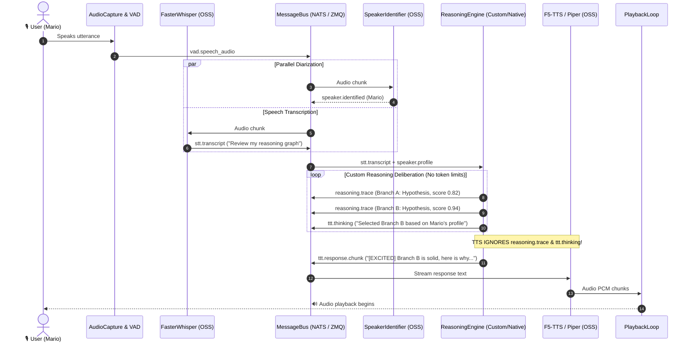

# 🏗️ MindMirror Architecture Review — v4 (Custom Reasoning & Full Open-Source Stack)

> [!NOTE]
> Builds on [v1](file:///home/mario/.gemini/antigravity-ide/brain/a9fc5123-8961-4061-b1e7-e92cf69dd33c/architecture_review.md), [v2](file:///home/mario/.gemini/antigravity-ide/brain/a9fc5123-8961-4061-b1e7-e92cf69dd33c/architecture_review_v2.md), and [v3](file:///home/mario/.gemini/antigravity-ide/brain/a9fc5123-8961-4061-b1e7-e92cf69dd33c/architecture_review_v3.md).
> This version introduces two major architectural pivots based on your requirements:
> 1. **Pluggable Reasoning Architecture**: Decouples the reasoning engine to support custom multi-step reasoning algorithms (Tree of Thoughts, MCTS, self-refinement/critic loops, graph search) while seamlessly retaining provider-native reasoning APIs (Anthropic, Gemini, OpenAI, DeepSeek).
> 2. **Complete Open-Source Software (OSS) Blueprint**: Concrete open-source service connectors for every message bus option and 100% open-source implementations for every pipeline component.

---

## 1. Critical Evaluation of Architecture Review v3

### What v3 Got Right
- **SpeakerProfile Parameter Overrides**: Treating VAD, TTS, and prompt tuning as runtime config in ChromaDB avoids overengineered model fine-tuning.
- **ComponentSupervisor**: Erlang-style process supervision with factory-based instantiation cleanly handles crash recovery without dirty state leakage.
- **Async Streaming StreamPhase**: Separating thinking deltas from response deltas ensures thinking is never vocalised.

### Where v3 Fell Short (and What v4 Solves)
1. **Passive vs. Active Reasoning**:
   - *v3 Flaw*: Treated "reasoning" purely as receiving thinking tokens emitted by cloud LLM APIs.
   - *v4 Fix*: Promotes reasoning to an **autonomous Reasoning Engine**. The engine can execute arbitrary custom search/planning algorithms (e.g. Monte Carlo Tree Search, iterative verification, multi-agent debate) that make multiple model calls, query ChromaDB memory, and emit real-time reasoning telemetry without being constrained by token budgets.
2. **Message Bus Hand-Waving**:
   - *v3 Flaw*: Suggested NATS and ZeroMQ conceptually, but only wrote a toy 5-line stub and lacked production connectors to actual open-source servers.
   - *v4 Fix*: Provides fully realised, production-grade connectors for **three distinct open-source services**: NATS Server (`nats-py`), Valkey/Redis Server (`redis-py` async / Valkey OSS), and ZeroMQ IPC (`pyzmq`).
3. **Open-Source Coverage**:
   - *v3 Flaw*: Relied heavily on Google Cloud and proprietary endpoints as primary examples.
   - *v4 Fix*: Establishes an explicit **Open-Source Alternative Matrix** for every single component in the pipeline (Audio, VAD, Speaker Diarization, STT, Reasoning/TTT, TTS, Vector Store).

---

## 2. Pluggable Reasoning Architecture

When exploring your own reasoning algorithms without token constraints, the reasoning engine must not be a dumb pass-through wrapper around a single `llm.chat()` call. It needs to be an **orchestrated reasoning graph**.

### 2.1 The Two Modes of Reasoning

```
                                 ┌────────────────────────────────────────────────────────┐
                                 │                User Query + Context                    │
                                 └───────────────────────────┬────────────────────────────┘
                                                             │
                                   Is custom reasoning algorithm configured?
                                            │                         │
                                          [YES]                      [NO]
                                            ▼                         ▼
                        ┌───────────────────────────────┐  ┌───────────────────────────────┐
                        │   Custom Reasoning Strategy   │  │   Provider-Native Reasoning   │
                        │   (MCTS, Tree-of-Thoughts,   │  │   (Gemini Flash Thinking,     │
                        │    Reflexion, Debate)         │  │    DeepSeek R1, Claude 3.7)   │
                        └───────────────┬───────────────┘  └───────────────┬───────────────┘
                                        │                                  │
                                        ▼                                  ▼
                        ┌───────────────────────────────┐  ┌───────────────────────────────┐
                        │ - Multi-step LLM rollouts     │  │ - Single streaming call       │
                        │ - Memory & tool exploration   │  │ - Passive thinking token parse│
                        │ - Evaluation / scoring steps  │  │ - Native budget controls      │
                        │ - Emits 'reasoning.trace'     │  │ - Emits 'ttt.thinking'        │
                        └───────────────┬───────────────┘  └───────────────┬───────────────┘
                                        │                                  │
                                        └─────────────────┬────────────────┘
                                                          ▼
                                            ┌───────────────────────────┐
                                            │ Synthesised Final Answer  │
                                            │ [STYLE] Vocalised text    │
                                            └─────────────┬─────────────┘
                                                          ▼
                                            ┌───────────────────────────┐
                                            │     TTS Speech Output     │
                                            └───────────────────────────┘
```

### 2.2 Core Reasoning Interfaces

```python
# mindmirror/llm/reasoning/interface.py

from abc import ABC, abstractmethod
from dataclasses import dataclass, field
from enum import Enum
from typing import AsyncIterator, Any

class StreamPhase(Enum):
    THINKING = "thinking"         # Internal deliberation (logged, visualised, NOT spoken)
    REASONING_STEP = "step"       # Discrete algorithm event (e.g. MCTS node expansion)
    RESPONDING = "responding"     # Spoken output (streamed directly to TTS)

@dataclass
class ReasoningStep:
    """Telemetry payload for custom reasoning algorithms."""
    algorithm: str               # e.g., "tree_of_thoughts", "mcts", "reflexion"
    step_id: str
    parent_id: str | None
    action: str                  # e.g., "branch_generated", "critique", "prune", "score"
    thought: str
    score: float | None = None
    metadata: dict[str, Any] = field(default_factory=dict)

@dataclass
class TTTStreamChunk:
    phase: StreamPhase
    delta: str
    step: ReasoningStep | None = None
    style: str | None = None
    is_final: bool = False

class ReasoningStrategy(ABC):
    """Base class for any reasoning algorithm (custom or provider-native)."""

    @abstractmethod
    async def reason(
        self,
        prompt: str,
        system_prompt: str,
        speaker_context: dict[str, Any],
        tools: list[Any] | None = None
    ) -> AsyncIterator[TTTStreamChunk]:
        """Stream reasoning events, thoughts, and the final vocalised response."""
        ...
```

### 2.3 Custom Reasoning Implementation: Tree-of-Thoughts / Iterative Refinement

Here is a concrete blueprint of a custom algorithm: a **Generator-Critic-Refiner with Branch Evaluation**. Because token costs are unconstrained, it explores multiple solution branches, critiques each against speaker preferences and persistent memory, and selects the optimal path before synthesis:

```python
# mindmirror/llm/reasoning/custom/tree_of_thoughts.py

import uuid
from typing import AsyncIterator
from mindmirror.llm.reasoning.interface import ReasoningStrategy, TTTStreamChunk, StreamPhase, ReasoningStep
from mindmirror.llm.interface import TTTInterface

class TreeOfThoughtsReasoning(ReasoningStrategy):
    """Custom reasoning algorithm: branch generation -> self-critique -> synthesis."""

    def __init__(self, generator_llm: TTTInterface, evaluator_llm: TTTInterface, branches: int = 3):
        self.generator = generator_llm
        self.evaluator = evaluator_llm
        self.branches = branches

    async def reason(
        self,
        prompt: str,
        system_prompt: str,
        speaker_context: dict[str, Any],
        tools: list[Any] | None = None
    ) -> AsyncIterator[TTTStreamChunk]:
        root_id = str(uuid.uuid4())[:8]

        yield TTTStreamChunk(
            phase=StreamPhase.THINKING,
            delta="Initiating Tree-of-Thoughts deliberation...\n",
            step=ReasoningStep(
                algorithm="tree_of_thoughts",
                step_id=root_id,
                parent_id=None,
                action="init",
                thought=f"Deconstructing user query: '{prompt}'"
            )
        )

        # 1. Parallel hypothesis generation (exploring N distinct thought angles)
        candidate_thoughts: list[tuple[str, str]] = []
        for i in range(self.branches):
            step_id = f"{root_id}_b{i}"
            gen_prompt = (
                f"Explore candidate angle {i+1}/{self.branches} to address this user request:\n"
                f"User: {prompt}\n"
                f"Propose a structured internal rationale."
            )
            resp = await self.generator.send_message(gen_prompt)
            thought_text = resp.text
            candidate_thoughts.append((step_id, thought_text))

            yield TTTStreamChunk(
                phase=StreamPhase.REASONING_STEP,
                delta=f"[Branch {i+1}]: {thought_text}\n",
                step=ReasoningStep(
                    algorithm="tree_of_thoughts",
                    step_id=step_id,
                    parent_id=root_id,
                    action="branch_generated",
                    thought=thought_text
                )
            )

        # 2. Critic & Evaluation step
        eval_prompt = (
            f"You are the reasoning evaluator for assistant MindMirror.\n"
            f"User query: {prompt}\n"
            f"Speaker Profile: {speaker_context}\n"
            f"Evaluate each of these thought branches on clarity, empathy, and technical rigor:\n"
            + "\n".join([f"Option {idx}: {t}" for idx, (_, t) in enumerate(candidate_thoughts)])
            + "\nSelect the winning candidate index and provide the synthesis rationale."
        )

        critique_resp = await self.evaluator.send_message(eval_prompt)
        yield TTTStreamChunk(
            phase=StreamPhase.THINKING,
            delta=f"Evaluator Verdict:\n{critique_resp.text}\n",
            step=ReasoningStep(
                algorithm="tree_of_thoughts",
                step_id=f"{root_id}_eval",
                parent_id=root_id,
                action="evaluated",
                thought=critique_resp.text
            )
        )

        # 3. Final Vocalised Synthesis (Streamed to TTS)
        synthesis_prompt = (
            f"{system_prompt}\n"
            f"Selected Best Deliberation:\n{critique_resp.text}\n"
            f"Now address the user directly. Start with an emotional style tag [NEUTRAL], [EXCITED], [SERIOUS], or [LAZY]."
        )

        async for chunk in self.generator.stream_message(synthesis_prompt):
            # Ensure phase is RESPONDING so TTS receives this text
            chunk.phase = StreamPhase.RESPONDING
            yield chunk
```

### 2.4 Provider-Native Reasoning Strategy (Gemini / Claude / DeepSeek)

For provider-native interfaces, the strategy acts as a high-speed translator that parses reasoning blocks or `<think>` tags and maps them to `StreamPhase.THINKING` without dropping provider-specific parameters:

```python
# mindmirror/llm/reasoning/native/provider_native.py

import re
from typing import AsyncIterator, Any
from mindmirror.llm.reasoning.interface import ReasoningStrategy, TTTStreamChunk, StreamPhase

class ProviderNativeReasoning(ReasoningStrategy):
    """Wraps native reasoning APIs (Gemini thinking budget, Claude thinking blocks, DeepSeek <think>)."""

    def __init__(self, client: Any, reasoning_budget: int = 2048):
        self.client = client
        self.reasoning_budget = reasoning_budget

    async def reason(
        self,
        prompt: str,
        system_prompt: str,
        speaker_context: dict[str, Any],
        tools: list[Any] | None = None
    ) -> AsyncIterator[TTTStreamChunk]:
        # Streams raw chunks from client, demuxing thinking from final response
        in_think_block = False
        think_buffer = ""

        async for raw_token in self.client.stream_raw(prompt, system_prompt, budget=self.reasoning_budget):
            if "<think>" in raw_token:
                in_think_block = True
                continue
            if "</think>" in raw_token:
                in_think_block = False
                continue

            if in_think_block:
                yield TTTStreamChunk(phase=StreamPhase.THINKING, delta=raw_token)
            else:
                yield TTTStreamChunk(phase=StreamPhase.RESPONDING, delta=raw_token)
```

---

## 3. Message Bus Connectors to Open-Source Services

You specified that **each bus type should provide an implementation of a connector to an open-source service**. Below are the three primary connectors, written against standard open-source servers.

### 3.1 Connector 1: NATS Server Connector (Recommended Distributed Bus)

- **Open Source Service**: **NATS Server** (`nats-server:v2.10`, Apache 2.0 license).
- **Client Library**: `nats-py`.
- **Key Advantages**: Ultra-low latency (<50μs), subject hierarchy, lightweight (<15MB Docker image), native JetStream persistence.

```python
# mindmirror/pipeline/transport/nats_bus.py

import asyncio
from typing import AsyncIterator, Callable
import nats
from nats.aio.client import Client as NATSClient
from mindmirror.pipeline.transport.interface import MessageBus
from mindmirror.pipeline.message import PipelineMessage

class NatsBus(MessageBus):
    """Production connector for the open-source NATS messaging server."""

    def __init__(self, servers: list[str] = ["nats://127.0.0.1:4222"]):
        self.servers = servers
        self.nc: NATSClient | None = None

    async def connect(self) -> None:
        self.nc = await nats.connect(
            servers=self.servers,
            reconnect_time_wait=1,
            max_reconnect_attempts=60,
            name="mindmirror-pipeline"
        )

    async def publish(self, channel: str, message: PipelineMessage) -> None:
        if not self.nc:
            raise RuntimeError("NatsBus is not connected. Call connect() first.")
        payload = message.to_bytes()  # MessagePack or Protobuf serialization
        await self.nc.publish(channel, payload)

    async def subscribe(self, channel: str) -> AsyncIterator[PipelineMessage]:
        if not self.nc:
            raise RuntimeError("NatsBus is not connected. Call connect() first.")

        queue = asyncio.Queue()
        async def cb(msg):
            parsed = PipelineMessage.from_bytes(msg.data)
            await queue.put(parsed)

        sub = await self.nc.subscribe(channel, cb=cb)
        try:
            while True:
                item = await queue.get()
                yield item
        finally:
            await sub.unsubscribe()

    async def close(self) -> None:
        if self.nc:
            await self.nc.drain()
            await self.nc.close()
```

### 3.2 Connector 2: Valkey / Redis Connector (Key-Value State + Pub/Sub)

- **Open Source Service**: **Valkey** (the LF-endorsed true OSS fork of Redis, BSD-3-Clause) or **Redis 7 (OSS)**.
- **Client Library**: `redis-py` (asyncio mode).
- **Key Advantages**: Excellent for shared control planes, ephemeral speaker cache, and pub/sub.

```python
# mindmirror/pipeline/transport/valkey_bus.py

import asyncio
from typing import AsyncIterator
import redis.asyncio as redis
from mindmirror.pipeline.transport.interface import MessageBus
from mindmirror.pipeline.message import PipelineMessage

class ValkeyBus(MessageBus):
    """Production connector for open-source Valkey / Redis Server."""

    def __init__(self, url: str = "redis://127.0.0.1:6379/0"):
        self.url = url
        self.client: redis.Redis | None = None

    async def connect(self) -> None:
        self.client = redis.from_url(
            self.url,
            decode_responses=False,
            socket_timeout=5.0,
            retry_on_timeout=True
        )

    async def publish(self, channel: str, message: PipelineMessage) -> None:
        if not self.client:
            raise RuntimeError("ValkeyBus not connected.")
        payload = message.to_bytes()
        await self.client.publish(channel, payload)

    async def subscribe(self, channel: str) -> AsyncIterator[PipelineMessage]:
        if not self.client:
            raise RuntimeError("ValkeyBus not connected.")
        pubsub = self.client.pubsub()
        await pubsub.subscribe(channel)

        try:
            async for raw in pubsub.listen():
                if raw["type"] == "message":
                    yield PipelineMessage.from_bytes(raw["data"])
        finally:
            await pubsub.unsubscribe(channel)
            await pubsub.close()

    async def close(self) -> None:
        if self.client:
            await self.client.aclose()
```

### 3.3 Connector 3: ZeroMQ IPC / TCP Connector (Zero-Daemon Same-Host Transport)

- **Open Source Service / Engine**: **ZeroMQ / libzmq** (LGPL-3.0 with static linking exception).
- **Client Library**: `pyzmq` with `asyncio`.
- **Key Advantages**: Zero broker daemon required. Runs directly over UNIX domain sockets (`ipc:///tmp/mindmirror.ipc`) with sub-10μs latency. Ideal for high-sample-rate audio buffers.

```python
# mindmirror/pipeline/transport/zmq_bus.py

import asyncio
from typing import AsyncIterator
import zmq
import zmq.asyncio
from mindmirror.pipeline.transport.interface import MessageBus
from mindmirror.pipeline.message import PipelineMessage

class ZmqBus(MessageBus):
    """Connector using open-source ZeroMQ for ultra-fast local socket IPC."""

    def __init__(self, endpoint_prefix: str = "ipc:///tmp/mindmirror_"):
        self.endpoint_prefix = endpoint_prefix
        self.ctx = zmq.asyncio.Context()
        self._pub_sockets: dict[str, zmq.asyncio.Socket] = {}

    async def connect(self) -> None:
        pass # ZeroMQ creates sockets on demand per channel

    async def publish(self, channel: str, message: PipelineMessage) -> None:
        if channel not in self._pub_sockets:
            sock = self.ctx.socket(zmq.PUB)
            sock.bind(f"{self.endpoint_prefix}{channel}.ipc")
            self._pub_sockets[channel] = sock
            await asyncio.sleep(0.01) # Allow connection handshake

        sock = self._pub_sockets[channel]
        await sock.send(message.to_bytes())

    async def subscribe(self, channel: str) -> AsyncIterator[PipelineMessage]:
        sub_sock = self.ctx.socket(zmq.SUB)
        sub_sock.connect(f"{self.endpoint_prefix}{channel}.ipc")
        sub_sock.setsockopt_string(zmq.SUBSCRIBE, "")

        try:
            while True:
                data = await sub_sock.recv()
                yield PipelineMessage.from_bytes(data)
        finally:
            sub_sock.close()

    async def close(self) -> None:
        for sock in self._pub_sockets.values():
            sock.close()
        self.ctx.term()
```

---

## 4. Complete Open-Source Implementation Matrix for Every Component

Here is the concrete open-source software stack for each pipeline stage:

| Component | Open-Source Implementation | Underlying Library / Engine | License | Why It's State-of-the-Art |
|---|---|---|---|---|
| **Audio Capture / Playback** | `PipeWireAudioDevice` | PortAudio / `sounddevice` + PipeWire | MIT / BSD | Low-latency audio graph with pro-audio isolation. |
| **Voice Activity Detection** | `SileroVAD` | Silero VAD v5 (ONNX Runtime / PyTorch) | Apache 2.0 | <30ms latency, 99%+ accuracy against background noise. |
| **Speaker Identification** | `PyannoteIdentifier` | `pyannote.audio` 3.1 (Hugging Face) | MIT | SOTA voice embeddings, cosine distance thresholding. |
| **Speech-to-Text (STT)** | `FasterWhisperEngine` | `faster-whisper` (CTranslate2) | MIT | 4x faster than vanilla Whisper, int8 GPU/CPU quantization. |
| **Reasoning Engine** | `CustomTreeOfThoughts` | Custom Algorithmic Python + `NetworkX` | BSD | Unconstrained search, state graphs, multi-turn rollout. |
| **Local LLM Serving** | `VLLMClient` or `OllamaClient` | **vLLM** (PagedAttention) / llama.cpp | Apache 2.0 | High-throughput local serving for DeepSeek-R1 / Qwen2.5. |
| **Text-to-Speech (TTS)** | `F5TTSEngine` & `PiperTTSEngine` | **F5-TTS** (Diffusion) + **Piper** (Fast ONNX) | MIT / Apache | F5-TTS for cloning; Piper for ultra-low latency (<50ms). |
| **Vector Memory** | `ChromaStore` | **ChromaDB** (SQLite / ClickHouse backend) | Apache 2.0 | Embedded or server mode, native embedding indexing. |
| **Message Transport** | `NatsBus` | **NATS Server v2.10** | Apache 2.0 | High-speed binary pub/sub with subject filtering. |
| **Process Supervision** | `ComponentSupervisor` | Python `asyncio` OTP Supervisor / systemd | Python PSF | Automatic backoff restart, zero state contamination. |

---

## 5. End-to-End Reasoning Integration Flow



---

## 6. Updated Implementation Roadmap

```
Phase 1: Bus & Envelope Primitives (P0)
├── PipelineMessage envelope (with StreamPhase & ReasoningStep)
├── MessageBus ABC
└── OSS Connectors: LocalBus (dev) -> ZmqBus (IPC) -> NatsBus (Docker)

Phase 2: Pluggable Reasoning Engine (P1)
├── ReasoningStrategy ABC & Telemetry Streamer
├── Custom Reasoning Engine: Branch Generator & Evaluator (Tree-of-Thoughts / MCTS)
├── Provider-Native Adapter: Gemini / Claude / DeepSeek parser
└── ContextManager with thinking-pruning strategy

Phase 3: Open-Source Engine Integrations (P2)
├── Faster-Whisper local STT component
├── Piper / F5-TTS local TTS component
├── Pyannote / SpeechBrain local speaker identifier
└── Local vLLM / Ollama reasoning endpoint integration
```
